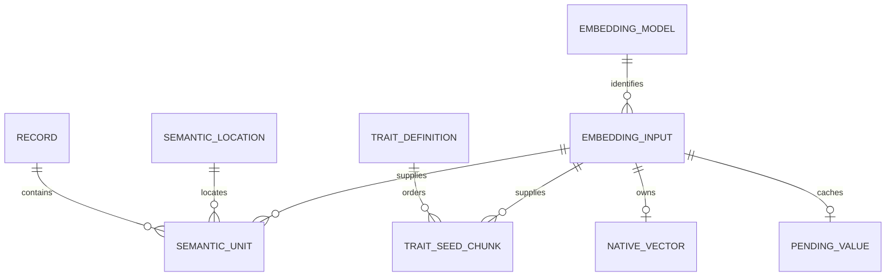

# ADR0065: Input-owned vectors and owned reference publication

Status: accepted

## Context

A semantic unit describes an occurrence in a record/profile/location. An embedding
input identifies exact prepared text and model execution. These lifetimes differ:
changing an occurrence need not change the numerical input another occurrence or
trait still uses. Storing reusable bytes in occurrence-addressed vector slots makes
bounded publication depend on copying selected values before those slots change.
Holding every reused vector in RAM or maintaining a full staging copy resolves
that hazard, at memory or temporary-storage cost.

The [ownership study](../../research/database-ingest-revision.md#retrieval-tradeoff) found only 0.629%
duplicate document excess. Its shared-input query prototype was slower than the
occurrence index, with approximately 44 ms extra broad warm SQL time at K=1,024.
Input normalization therefore has an explicit retrieval tradeoff. The accepted
reason for it is stable numerical ownership and a simpler publication lifetime.
Those observations do not establish final ingest speed or product search quality.

Early pruning of recovery work also couples cache eviction to complete historical
build membership. Treating recovery data as a disposable cache lets eviction cost
recomputation without threatening a prepared publication.

The initial implementation also independently audited the whole result before
every publication and retained a durable quarantine marker after rollback. Review
showed these were broader obligations than ordinary ingest needed: a failed update
need not establish the health of the state it restores, and typed construction can
maintain private relationships without replaying each representation. The refined
boundary keeps atomicity and explicit deep audit while trusting untouched data.

## Decision

Store one active searchable native vector per full model/input identity, addressed
by input_id in model-owned native_vectors tables. Occurrences and ordered trait
chunks reference that input; retain their separate record/location identities.
Derived trait centroids remain separate. There is one permanent native authority,
without a second full occurrence-vector projection or compulsory value versions.

These are logical relationships. A registry input can have a published vector
and a pending replacement; only the published value is searchable. Repeated
occurrences and trait chunks retain separate attribution while sharing that value.

A forced result can differ for the same input. Bind the selected checksum as well
as model/input/token identity. Keep new or forced bytes in owned attempt staging,
then replace the active value only inside atomic publication. Every new-generation
consumer must use that selected value. Preserve ordered/repeated trait weights
and invalidate numerical derivatives even when input text hashes are unchanged.
Reclaim an input only after all document/trait consumers finish and no retained
recovery value needs its metadata.

Use one concrete prepared-publication owner for the captured context/inventory,
expected workspace generation, prepared metadata and build-local value selection.
Typed record append seals compact identities while each record is in hand; the
constructor and private interfaces maintain their relationship without a rich
replay. Private frames retain bounded structural decoding rather than checksums.
The embedding owner checks each inference output contract once. Durable recovery
and repack bytes receive shape/checksum checks when consumed; actual numerical
calculations and explicit audit retain their numerical checks. Stable published
values remain identity/checksum handles without payload reads merely for reuse.
Only values absent from the target profile require numerical staging. After a
layout change, that includes compatible prior values selected under
[ADR0066](0066-embedding-compatibility.md).

Current-schema fixtures publish through this same owner. Their explicit numerical
values are staged directly, so unrelated pending values cannot override fixture
intent. Historical fixtures seed their released representation separately and
exercise real upgrade callbacks; they do not retain another incremental publisher.

One attributed text stream feeds per-profile bounded prepare/select/infer windows,
without a separate corpus prevalidation or descriptor stream. Prepare each window
once and infer its missing subset; retain every occurrence and ordered trait
repetition while deduplicating numerical work. Drop each profile's inference runner
before the next profile. A later input error may preserve earlier useful recovery
work, but cannot publish partial reference data.

Inference runs outside database transactions in bounded batches. Reuse precedence
is same-attempt selection, matching unpublished recovery value, compatible
published value when reuse is enabled, then inference. Forced execution deduplicates
within the attempt. Cache hits and new inference become owned staged bytes before
cache eviction can invalidate selection.

Retain one recovery value per exact model/input key across failed attempts. Use
simple oldest-first eviction under a coarse logical-payload cap; it is not a
staging quota or physical-space reservation. Clear recovery values only with a
successful complete source-ingest publication. Schema upgrades and metadata-only
projection refreshes preserve the cache because they do not publish pending
numerical results. Do not maintain candidate/active/retired build
membership merely to make early eviction safe.

Group disposable files in one fresh attempt directory under the OS temporary
location while holding the workspace update lock.
Close every child handle before deleting the directory, including Windows error
paths. Normal completion/error removes owned scratch; a subsequent explicit update
may clean marked abandoned attempts for that same workspace in the current
temporary location. A crash before the attempt marker can leave an empty directory.
Ordinary reads and startup perform neither inference nor scratch/cache cleanup.

Publish the captured input set. Check external bytes against capture when consumed,
then use the owned data without consulting that file again. Manifests, catalogs,
pack bindings and alias preparation follow the same contract. Later source edits,
additions and removals belong to the next build; remove the final freshness rescan.
Retain optional Git provenance only when the clean checkout revision agrees
before and after capture. The captured content fingerprint remains authoritative.
Missing or unreadable declared packs still fail capture, while existing empty packs
and deliberate declaration removals remain valid.

Maintain one SQLite workspace and one immediate source-publication transaction.
Data-only publication shares admission with readers on committed snapshots.
Structural SQL requires exclusive admission. A guarded attempt that discovers
structural work rolls back fully before exclusive replay. Typed construction, identity/binding checks and SQL
constraints establish the write contract; ordinary ingest trusts untouched
committed state. Derive each root's related outputs together and reconcile only
changed components and their dependencies. Keep full consistency checking in the
explicit `atlas index validate` operation rather than rebuilding expected outputs
inside every ingest.

Normal source publication adds no durable maintenance marker. Rollback or process
termination permits reopening the previous committed state even if it was already
damaged; the new update is not responsible for repairing it. Reject pre-existing
markers, and retain durable maintenance/recovery for schema/metadata upgrades and
physical reclamation. Setup and upgrades may be maintenance windows. Failed
activation preserves saved state and committed recovery results; private staging
failure cannot authorize partial publication. Existing build/force meanings remain.

## Retrieval contract

Admit only native inputs with an eligible occurrence before nearest-neighbor
selection. Expand a hit only into eligible occurrences, retaining exact record,
owner, field and passage attribution. Trait-only and pending values cannot become
document candidates. Preserve Core, exclusions and configured Similar role,
correspondence and identity masks at the appropriate query boundary.

K remains an occurrence budget. Selecting K eligible inputs, expanding occurrences
and capping back to K preserves the nearest occurrence-distance multiset. Native
cutoff ties can choose different occurrence witnesses; the outer sort does not
establish a globally deterministic cutoff. A unique-input coverage policy is a
separate retrieval decision. Native-neighbor cache recipe/generation admission must
follow the new lookup while retaining the bounded occurrence payload contract.

## Migration and alternatives

Published migrations and their transitive executable behavior remain immutable.
The unreleased PR suffix describes the final transformation directly from main:
no schema step creates experimental target history only for a later step to remove
it. Numerical conversion precedes section backfills that can reach current native
validation. Copy and verify every old occurrence and trait-only value through public
vector SQL, preserve pending values independently, then retire old storage inside
the same upgrade transaction. Preserve exact vector bytes, saved identities,
clock/tracker payloads and published historical callbacks; no inference or source
access is required for numerical conversion.

Keeping the occurrence index plus owned transient staging remains a conservative
alternative with less retrieval disruption. A separate stable numerical authority
plus an occurrence index preserves that query shape but duplicates roughly 987 MB of
logical permanent payload at the studied corpus size. The accepted design chooses
stable input ownership and one native authority instead.

## Consequences and validation

The design removes occurrence-slot reuse hazards and the need for a full reused-
vector copy. It introduces eligibility translation/occurrence expansion in native
queries and requires evidence for the actual integrated cost. Common captured-input,
preparation and cache simplifications apply independently; measure their benefits
without crediting every improvement to numerical normalization.

Validate real schema upgrades, rollback/crash recovery, saved/clock/receipt
preservation, forced numerical replacement, trait-only transitions, profile changes,
eviction after selection, consumed-input changes and bounded temporary storage.
Protect all product retrieval consumers and cache lifetimes. In-memory feasibility
fixtures and isolated SQL comparisons do not establish product integration,
migration peaks, relevance quality or final ingest performance.

This amends the numerical ownership, recovery-cache, source-freshness and
publication-assurance portions of [ADR0051](0051-persistent-workspace.md) and the numerical execution/publication
portions of [ADR0050](0050-selectable-search-profiles.md). Their workspace/session,
profile identity, source authority and atomicity boundaries remain active. The
[runtime](../runtime.md) and [artifact contract](../artifact-contract.md) own current
composition and stored-family details.
