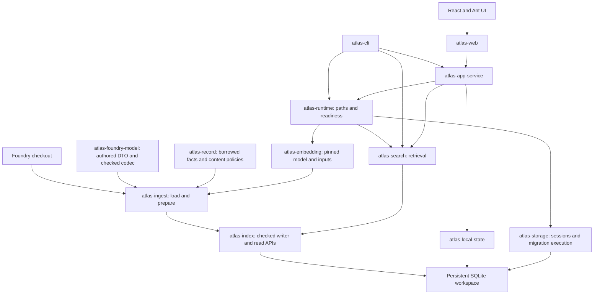

# Runtime architecture

Runtime reads use the source-backed reference portion of a persistent workspace. Build-time admission,
filesystem discovery and developer reports remain separate from product retrieval.
See the [overview](./overview.md) for crate ownership and the
[artifact contract](./artifact-contract.md) for storage/validation.

## Pinned reference acquisition

Runtime acquires the exact PF2e commit emitted by model generation from the
canonical source pin (ADR0052). Default source caches are keyed by commit and
published only after a detached checkout is complete and clean; setup never pulls
upstream HEAD. Explicit or persisted user source directories are inspected without
mutation. Ingest rejects incompatible PF2e system manifest versions before product
preparation; developer admission reports remain usable for unsupported sources.

## Source loading and checked records

Private TypeScript tooling resolves pinned Foundry declarations and emits modular
Rust under `atlas-foundry-model/src/source_model/generated`. Large extracted
graphs are ignored caches; CI regenerates/checks committed Rust. Ordinary builds
need neither Node nor the upstream checkout. Generation ownership, recursive
identity, templates and authored profiles follow ADR0034–40.

Strict authored parsing and admission are distinct. Admission retains useful
records with explicit invalid members and diagnostics; malformed collection
members are not silently dropped or reordered. Specific rule interpretation stays
atomic and separate from generic Item rule retention. See ADR0041. Ingest's
`load_foundry_documents` preserves file order, bytes/hashes, provenance and explicit
quarantines/unaddressable outcomes; it does not construct product schemas.

`SourceBackedRecord` derives a checked key from an admitted DTO and exposes an
immutable body. Its shared traversal processes borrowed nodes using an active
owner chain, rather than storing a global inventory. Consumers request concrete
owner/content addresses. Family/common query and presentation views borrow actual
typed fields and preserve unavailable states. There is no DTO-to-AtlasRecord
normalization step or separately maintained runtime family authority.

`encode_snapshot`/`decode_snapshot` belong to `atlas-foundry-model`. Decoding reads
the tagged checked representation with version/identity/recursion guards; it runs
no source admission, defaults or repairs. Original complete source JSON is not
duplicated in the artifact. Developer source inspection can read the checkout;
normal runtime reads use the checked codec and work without it.

Trait reference reads likewise use published source evidence and prepared
definitions without opening Foundry localization files. Their separate typed
identity, exact source memberships/references and stored semantic seeds follow
[ADR0056](./decisions/0056-trait-reference-entities.md). Publication and schema
upgrades use the same bounded workspace and state-preserving migration owners.
`atlas record source` explicitly exports a product record's complete checked
snapshot and compact provenance through the existing retrieval/app-service path.
This inspection does not use presentation projections or read the source clone.
The shared model-owned JSON inspection helper preserves the codec's depth guards;
developer original-file inspection remains a separate hash-verified operation.

## Build and preparation

Ingest first establishes source/reference identity, then supplies explicit locale,
audience and resolver context to record-owned preparation and relationship policies.
The record itself remains a key and DTO. Content outcomes and resolved relationship
occurrences are separate derived outputs. Original bytes/provenance, admission
failures and detailed reports remain ingest/developer concerns.

`BuildArtifactOptions` composes source paths, locale, selected profile configurations,
batching/reuse and output paths. An empty profile collection builds lexical content.
The build prepares shared source content once, then checks native inputs and runs
inference/reuse sequentially per selected profile. It produces index-owned inputs: checked
records, named typed projections, selected content, verified identity evidence and
attributed lexical/semantic units. The index writer owns physical encoding and
publication. A failed publication rolls back reference changes and preserves saved state.

The aggregate source fingerprint hashes the ordered actual relevant inputs,
including manifest/pack definitions and excluded records. A Git revision alone
does not capture exported checkouts or local edits. Shared content preparation
identity includes locale/catalogs, audience and content/relationship/selection
policies; it excludes profile model assets and passage recipes. Each profile's
execution/reuse identity binds its complete selected model/native-tokenizer assets,
the full shared BGE segmentation-tokenizer digest and its passage recipe. The full
artifact generation binds shared preparation plus the complete profile manifest.
Embedding checkpoints persist exact model/input identities, input hashes, token
counts, vector checksums and dimensions independently of the active reference.
Ingest prepares current inputs with the pinned tokenizers and accepts only exact
checkpoint matches. Profile-native preparation produces an immutable checked
batch in `atlas-embedding`; checkpoint lookup and generation consume the same
counts and execution identities without repeating full-batch token validation.
Uncached inputs retain the inference tokenizer checks. An inference session is
loaded only when that batch contains uncached inputs. Verified checkpoint vectors
are borrowed during generation rather than copied into another full-profile map.
Each inferred batch commits separately after computation;
no SQLite write transaction remains open during inference. Final publication
activates complete profile coverage and prunes checkpoints not used by active
profiles. A failed preparation retains reusable batches for a retry.

Unchanged admitted sources reuse checked DTOs and prepared content when the source
and preparation identities agree. References are resolved again against the current
identity catalog, including previously unresolved targets, so dependency changes
can invalidate a dependent record without changing its own source bytes.

The content interpreter produces sanitized HTML and narrow marker/control facts
using the shared HTML parser and sanitizer.
The selected cache is stored once per field; authored markup remains in the DTO.
CLI formatting is derived with html2text at read time. UI controls use field-local
ordinals and intentional app contracts, never arbitrary Foundry JavaScript.
Initial indexing includes GM/owner text/DCs and excludes None; English is the
overridable build default. Search/display initially use artifact locale.

Lexical selection uses names, verified aliases, typed vocabulary, actual owned
labels and meaningful structural definition labels. It does not dump descriptive
prose into FTS. Semantic selection independently covers selected explanatory
root/owned passages plus compact root identity. text-splitter segments passages;
the actual tokenizer checks every final input with complete body/tail coverage.
FastEmbed executes pinned BGE Base CLS/L2 and EmbeddingGemma's exported projected
sentence output with L2 normalization. Both profiles share baseline BGE segmentation;
the selected native tokenizer checks every officially prefixed final input.
[ADR0050](./decisions/0050-selectable-search-profiles.md) pins these boundaries.

## Runtime paths and setup

The workspace lives in platform application-data storage; source checkouts and
model assets remain in platform cache storage. Explicit repo mode uses
`vendor/pf2e`, `.cache/hf-models` and `.atlas/workspace.sqlite`. Source path,
manifest, locale and requested profiles are durable configuration independent of
active reference output. Explicit setup overrides update that intent; omitted
options preserve it. Adding a profile retains already requested profiles.

Runtime composes reference and saved-domain SQL into one ordered migration ledger.
Storage verifies ledger checksums, backs up existing workspaces before structural
upgrades, and commits migrations, backfills and validation atomically. Supported
query-catalog changes rebuild typed projections from retained DTOs without source
admission or inference. Other component changes require their corresponding
preparation work; physical schema version alone is not an inference invalidation.

One update owner serializes configuration/source publication. Maintenance drains
cooperating sessions and records durable admission closure. Publication validates
inside its final transaction before advancing the reference revision. Interrupted
maintenance is recovered only after validating committed data; failed validation
keeps admission closed. The workspace file and saved tables are never replaced by
normal setup. Existing pre-release formats are rejected explicitly; the new
baseline establishes the migration path for subsequent upgrades.

Setup owns source-fetch/offline policy, pinned model preparation and readiness.
Records-only operation needs no query embeddings. English is the fresh indexing
default. The embedding crate owns checksum/cache readiness without loading models.
Fresh semantic setup selects BGE Base. Cache packages use model-ID/revision
directories; missing or corrupt files are repaired through verified temporary
download and rename. Old package revisions remain untouched.

Explicit setup freshness may compare the source fingerprint. Ordinary lookup,
search, lists and encounters do not scan the source checkout. Cheap index checks
validate the executable contract/capability; deep coherence validation is an
explicit diagnostic/build-publication operation. Model-free lexical and stored
vector workflows remain deliberate modes rather than implicit web fallbacks.

## Retrieval and application workflows

CLI and web operations use bounded read sessions rather than retaining database
snapshots between requests. A composed reference/state read shares one connection
and transaction. Source-free lists and encounters can operate before reference
publication. App-service receives typed `WorkspaceRead`, `StateRead` and
`WorkspaceWrite` capabilities; it does not open databases or coordinate raw SQL.

Saved-list creation with initial entries resolves inputs against one reference
revision, then creates the list and applies successful inputs in one bounded write.
Input resolution failures are per-item outcomes; systemic errors roll back the
whole action. Entry-note reads and writes use saved-state sessions without reference
hydration, returning the committed note and canonical list/entry identity. Notes
remain editable when their reference records are unavailable.

Shell completion uses separate app-service read functions over resolved runtime
paths. It never runs normal service startup migrations or loads inference. Index
owns the bounded product-key prefix SQL; search forwards the typed read. Completion
failures produce no saved-value candidates and never fall back to another workspace.

Web retains a bounded worker queue and runtime/inference owners. Idle workers hold
no reader. Each operation observes one coherent reference revision; later
operations can see a completed publication without restarting the service.
Semantic queries prepare their embedding before opening the consuming session,
then recheck the profile contract. Default query-profile warming and retained
model sessions are independent of database lifetimes. Lexical/reference reads and
stored-vector Similar remain model-free.

One global native mutex serializes model loading/inference, with four inference
threads and the existing bounded worker queue. It releases before SQL ranking.
Stored-vector Similar and lexical/reference operations do not require query assets.
Profile readiness reports stored vectors, verified assets and query usability
separately for stored profiles only, without constructing a native session for
metadata checks. App-service readiness retains the same runtime as query workers.
Required-file metadata witnesses retain verified availability until the package
changes; normal repair is observed on a later check. Native loading still verifies
actual bytes, and an already-loaded session remains usable after disk changes.
The inference owner publishes its finite loaded-profile snapshot after successful
session insertion, so metadata does not wait behind the native inference lane.
Omitted launch selection remains optional until runtime resolves the manifest:
sole profile selects itself, both select BGE Base. Explicit missing choices error.

Build owners emit existing `atlas_progress` events with profile IDs/names, stages,
completed/total work and separate occurrence/unique/reuse counts. CLI-support owns
TTY in-place and bounded nonTTY stderr rendering, elapsed/rate and supported ETA;
unknown work stays unknown. JSON stdout and disabled progress remain clean.

Search pages, contextual filter counts, and both contextual and count-free value
discovery receive an explicit, non-serialized `ReadExecutionContext`. Unrelated callers
choose an uncancellable context. App-service checks abandonment before lazy open
and queue admission, before a worker enters its expensive closure, and after
completed retrieval before app projection. A canceled queued item can retain its
slot and blocking waiter until drained; the contract saves work rather than
promising immediate capacity reclamation.

Web's `call_read_service` keeps an abandonment guard in the awaiting handler
future and delegates to the existing bounded blocking-call helper. Dropping the
wait marks the context; the actual blocking closure retains its semaphore permit
until completion. Started SQL/model work can finish before reaching the next
checkpoint. This does not introduce native interruption, deadlines, or a promise
that every browser abort drops its server handler. Durable mutations, transaction
receipts and their reference reads use the normal uncancellable path under
[ADR0048](./decisions/0048-atomic-mutable-workflows.md).

`AtlasRetrievalService` is a concrete service over index, an explicit default
profile and an optional prepared query embedding. Narrow inherent methods own strict name/key lookup, browse, text search,
similar, graph, remaster links, Suggested variants and catalog discovery. The
service uses the concrete index reader defined by the artifact contract.

The shared predicate compiles to index-owned parameterized eligibility SQL.
CLI CEL and UI structured requests independently target it. Applicable source
fields retain value/missing/null/invalid/not-applicable states; only true matches.
Same-child Exists preserves one witness. Facets use the same bindings and explicit
self-exclusion semantics. Index analysis returns typed optional unavailability for
valid unsupported suggestion contexts before search loads embeddings or ranks
candidates. Malformed predicates, wrong targets/scopes, invalid types and bounds,
and actual model/SQLite/service failures remain errors. CLI raw discovery presents
unavailable contexts as actionable command failures without another analysis.

Count-free vocabulary is a separate discovery request with artifact or saved-list
membership scope, value-search text, bounded paging and selected literals. It has
no query predicate, query text or retrieval mode. App-service resolves saved-list
keys; search forwards scope without embedding; index enumerates known applicable
product values before edition preference. Empty membership remains empty, and
retained selections do not inflate suggestion totals. Contextual counts retain
their exact same-child/counterfactual/remaster and bounded-candidate semantics.
The app counts operation accepts a bounded explicit literal page, independently
of vocabulary enumeration. It uses the same index-owned counterfactual compiler
and counts distinct displayed roots for each replacement literal. Text context
returns optional unavailability before inference, after field/literal/target
validation. Raw CLI field counts retain availability states and numeric extrema.
Shared browser pickers request optional counts only while open, retaining their
independent vocabulary when counts are unavailable or fail.

Index owns useful human labels alongside executable filter definitions.
App-service adds collection-context prefixes, groups, choice and operator labels
and one ordered common field list: Kind, Level / Rank, Rarity, Traits. Presentation
decoration does not declare executable fields or choices.
Editor catalog discovery is independent of active criteria and saved-list
membership. It remains available to repair invalid URL conditions. Operator
metadata includes the input shape (scalar, list, range, availability or nested
predicate); rendering and value transitions use this contract. Executable search
and contextual counts retain their separate index-owned validation.
The common Level / rank primitive is index-owned and uses existing rank/state
for spells and level/state for other applicable families.

FTS and sqlite-vec apply filters, key scopes and product eligibility before top-k.
Search aggregates matching units to one root result while preserving useful
root/owned/field/passage witnesses. Semantic scoring uses max per root, hybrid
defaults to fixed score fusion, and candidate windows remain bounded.
`SearchRanking` also permits an RRF60 dogfooding alternative (ADR0053).
CLI `--ranking` and the browser's URL-preserved ranking selector carry that choice
independently of the embedding profile; adapters do not implement ranking policy.
Verified legacy preference applies only among records matching the complete request,
before paging. Exact legacy keys remain accessible. Macros are excluded on every
product path; RollTables remain browse/search/detail records.

Text search and semantic contextual discovery share an exhaustive query-embedding
error conversion. Empty input and exact token-budget overflow remain invalid
requests, with useful counts and a shortening instruction; model/cache/inference
failures retain their availability classification. Queries are never truncated or
downgraded to lexical retrieval to conceal semantic input errors. Optional facet
availability is still checked before embeddings when its context is unsupported.

Index summaries and selected cache bundles are body free. Explicit detail decodes
one root and batches required fields. Search result witnesses do not cause
per-field/per-marker body reads. Reader connections stay on one generation while
the writer atomically publishes later artifacts.

App-service search pages reuse browse, text and stored-vector Similar retrieval.
Similar mode carries the exact root seed and canonical filters, and returns a
body-free seed summary beside bounded candidate pages. It adds no ranking lane or
query embedding. Every request supplies its complete criteria, page and optional
expected artifact generation. The generation check precedes embedding and ranking;
a mismatch returns `ArtifactGenerationChanged` with HTTP409 and expected/actual
context hashes. There is no app window registry or handle lifecycle. Each page
still performs retrieval independently, including query inference where needed;
the API does not promise a frozen semantic candidate set or cache speedup.
Browser URL state owns the removable seed criterion. Similarity uses catalog
choices and vocabulary without text-scoped contextual facet counts.

Result ordering is separate from candidate admission. An omitted order resolves
to Name A–Z for browsing, Relevance for text/Similar, and Saved order for lists.
Attribute rules and seeded Random order apply to the complete eligible browse/lexical set or the
complete accepted semantic set before pagination. The existing adaptive semantic
unit window and hybrid lexical union do not depend on order or page. Coverage,
witnesses and generation retain their existing meaning; no frozen-window registry
or lexical fallback is introduced. Requests retain optional order intent while
responses report the effective order. Invalid context/order combinations fail
before query inference. Contextual facets remain independent of ordering.

Domain owns the typed order: Relevance, Saved order, an ordered nonempty sequence
of unique name/level/unit-price rules, or Random with a u32 seed. Index owns
comparison over existing typed projections. Each rule places unavailable values
last in either direction, proceeds to the next rule for ties, and finishes with
normalized name ascending then canonical key ascending. Random uses stable
seed/key hashing over the complete eligible key set, with only the page hydrated
for browse. It never changes eligibility or shuffles a loaded page in isolation.
Saved-list attribute and Random ordering are read-time app-service views of hydrated
members and never write positions or notes. Unavailable members retain their saved relative order
at the end of unfiltered views, and explicitly saved edition members remain
present. Unit-price ordering compares stored per-item copper; app-service formats
an optional summary label from one typed batch of visible-root price facts,
without additional source-body reads or an artifact rebuild. Any unit-price rule
in the sequence enables these labels. Requested order, rule priority and Random
seed belong to URL/request identity; only Shuffle or an explicit seed edit changes
the seed. Paging and generation recovery retain it.

The browser search owner keeps the current generation and request epoch. Query
keys include criteria, page and generation; first-response adoption reuses the
completed page without a second inference request. Generation conflicts pause
paging and offer `Refresh results`. Recovery cancels affected immutable queries
before removing their data, advances the epoch and restarts at page1 with the same
criteria. Previous-page data never crosses generations. Saved lists, encounter
aggregates and dirty drafts survive this reset. Signals and epoch checks prevent
late old reads from restoring retired data. Similar previews reload their actual
owning detail before retrying against a new generation, including encounter-owned
reference previews. Snapshot-local owner selections remain exact.

One bounded app-service Related operation returns verified nonempty categories
with separate empty, unavailable and error outcomes. Its reference scope is the
exact selected owner (including the empty root owner path). Verified counterparts
and typed variant checks apply only to roots. Variant checks retain their bounded
source-snapshot compatibility verification; category discovery never runs Similar
ranking. Responses and browser caches use the complete selection and immutable
artifact-context hash, distinct from snapshot-local navigation fingerprints.

Relationship-scoped full search uses the existing stateless search-page workflow
with typed constraints composed conjunctively beside the ordinary predicate and
optional saved-list keys. Incoming constraints keep the selected destination exact
and choose root-only or root-plus-contained source references. Outgoing constraints
choose the exact selected source or that source plus descendants, never siblings
or parents. Index-owned SQL eligibility applies before lexical/vector candidate
selection, edition preference, distinct-root ordering and paging. Root totals are
independent of occurrence-preview caps. App-service supplies checked human labels
and bounded per-root evidence; occurrence pages retain exact source/target
navigation and their own complete occurrence totals. The browser never derives
eligibility by filtering Related's bounded neighbor keys. Contextual filter counts,
value discovery and field statistics retain relationship eligibility while
self-excluding the edited ordinary field. Saved-list membership intersects that
same scope; repeated occurrences never inflate root counts. Relationship selection
and generation participate in discovery request/cache identity. Existing text and
unsupported-predicate count policies remain unchanged, and count-free vocabulary
retains its independent artifact/list scope.
See [ADR0057](./decisions/0057-relationship-scoped-search.md).

App-service owns workflow composition/search pages, catalog-to-editor controls,
semantic family presentation and local-state hydration over runtime/search.
Detail retains a body-free root summary, full selected address, and selected-node
identity beside prepared content, useful owned links and an explicit family body.
Authored reference extraction is independent of encounter composition; the private
encounter arithmetic workspace is never transported. Encounter participants have
one composed presentation beside their durable local state, with explanations
attached to adjusted facts. Fact availability distinguishes missing, null, invalid
and not-applicable parents from known zero, false and empty collections.

Transient physical price facts retain availability for each currency, and table
results retain collection availability with one owned-link collection in the
table body. App-service supplies compact kind/level/rank captions from typed
facts. Shared readers omit optional known-empty baseline rows and empty headings
without altering source facts; required/unavailable values and explicit authored
clear/empty changes remain visible. No stored visibility flags or HTML emptiness
parser participates in this policy.

Spells and their owned copies display contextual casting ranks and supported
fixed/interval heightening over a transient checked-source copy. Invalid context
and unsupported calculations remain explicit. Partial form changes remain
reference information; interactive form execution is deferred. Rank preview is
read-only. Encounter casting separately spends revision-checked participant
resources or toggles manual expenditure markers; it does not roll dice, execute
effects or advance turns. Renderers share semantic responses while independently formatting
terminal and browser layouts. Complete selected navigation drives detail caching
and reader transitions. Root terminal summaries stay body-free.

Selected immediate Actor casting entries obtain associated local spells from the
already-decoded checked parent, preserving complete owner addresses. Root activity
rosters expose base and explicit authored cast ranks without duplicating the
roster in each entry. Hazard defense-block applicability is projected explicitly:
known zero AC and maximum HP suppress the primary block while original facts and
valid zero saves remain retained. Shared reference layouts put prose first;
encounter layouts prioritize combat state. Immediate Ability-class actions, effects and feats read inline by default through
bounded embedded-reading batches: one checked parent decode and one attributed
prepared-content batch, up to 32 entries and 256 fields. Roll-table result reading
uses the same bounded owner with range facts retained in the parent presentation.
Table reference rolls remain non-consuming; matched results are shown even when
their reading page is not loaded. Index owns exact
locator SQL and complete relationship attribution for each delivered field.
Fields exceeding the 1024 occurrence response budget have an explicit bounded
outcome; valid rich content is never delivered with silently disabled links.
Separate non-content relationship discovery remains bounded. Reading continuations
and browser caches bind the checked reference generation; partial content never
seeds selected-detail caches. Direct late-owner landing loads its bounded range
without predecessor reads and retains explicit backward/forward continuation.

All browser reference consumers render the same family meaning, including native
previews and comparison; compact changes density only. Shared prepared content
renders authored controls and exact links. Scrolling the actual reading container
near continuation starts the next finite batch; an idle visible sentinel and a
collapsed section do not start further batches. Complete checked owner anchors
are distinct from selected-detail addresses. Native permalinks preserve modified
clicks, and parent return retains known search/list/reader context and a checked
reading landing.

Encounter quick lookup requests the same complete selected-document view as other
reference readers. App-service checks the participant against current local state,
decodes one checked parent, reads selected content and composes the bounded runtime
overlay in Rust. Casting entries retain their associated local spell roster;
equipment keeps its customized authored view. Spells retain full authored details
and current runtime notes without calculating spell forms or damage adjustments.
Runtime detail uses a separate cache keyed by participant presentation and complete
selection; it never seeds immutable reference caches. Changed participants, stale
generations and missing selections remain explicit. Content-free
hydration captures the artifact generation in the same deduplicated retrieval;
source-free encounters have no generation and require no artifact open. Invalid
referenced participants remain unresolved rather than becoming manual records.

An embedded reader can offer an Original record link only for a resolved explicit
CompendiumProvenance relationship. It opens the current local catalog record,
while the selected reader and its full-page permalink retain the embedded copy.
There is no name-based pairing or substitution of catalog data into local copies.

Web startup uses
full pooled retrieval; short-lived CLI workflows may choose explicit model-free
or stored-vector modes. The bounded executor preserves parallel SQL retrieval;
the shared native inference owner serializes only model loading and inference.
Web routes are transport glue. App-model generates intentional browser DTOs;
the browser neither receives whole Foundry bodies nor reimplements gameplay rules.

Web hosting embeds the built frontend into debug and release binaries. A running
server retains its compiled frontend/backend pair when later builds change the
checkout's frontend output. Frontend hot reload uses the separate Vite dev server.

Saved lists/encounters preserve unresolved snapshots and explicit user choices.
Actor display uses authored baselines with bounded source/participant/condition
overlays and unapplied-context notes. New HP starts from a known integral effective
maximum; unknown does not become zero. Source adjustments apply once, explicit
participant choices replace them, and saved HP/overrides/edit intent survive
artifact rebuilds. No Foundry world execution or guessed aggregate mechanics is
introduced. Local-state migrations preserve existing ambiguous values.

Encounter HP actions carry participant identity, expected revision and one explicit
operation: damage, heal, exact current/temporary/maximum correction, or derived
maximum reset. App-service interprets raw integer addition/subtraction input against
the checked current participant, then reuses provenance policy and the transactional
replacement guard. The bounded shortcut accepts one initial plus/minus sign.
Enter sends signed Heal intent (positive heals, negative damages); negative Damage
or Heal amounts reverse the operation in Rust before applying its complete policy.
Exact correction formulas retain their zero floor and never acquire a maximum
clamp. Null explicitly clears
current/maximum availability. Formula length, arithmetic and browser-safe final
input bounds are checked; dice and general expressions are unsupported. Damage
absorbs temporary HP first, floors current HP at zero and marks zero HP defeated;
healing caps at a known maximum and does not clear defeated. Missing current HP
rejects damage/healing rather than inventing a value. These actions return the
same durable receipt, independently of subsequent presentation refresh. The
three-field HP editor sends SetValues with only supplied raw inputs; an explicit
null inside a current/maximum wrapper clears availability. All fields parse before
one guarded replacement, preserving omitted values/provenance and same-value
maximum edit intent. Condition-specific manual notes use canonical rule identity
and exact condition IDs; noncondition diagnostics omit that ID. The browser can
place these notes on their cards without hiding unrelated runtime context.

Local-state initialization and migrations commit schema and metadata together.
List metadata/tags, quantity additions and removal with replacement turn each
have one write transaction. Next turn chooses from the same locked snapshot it
updates, using pure app-service policy. A side-effect-free turn review returns the
encounter revision; Continue checks it in the immediate transaction before applying
old-END/new-START duration decrements and the new turn. Every relevant durable
encounter mutation advances that revision. Duration rounds store one remaining
amount and explicit participant/event anchor; zero retains the condition until
explicit removal, unresolved anchors never tick, and nonround units are reminders.
Manual Set turn, reorder and removal never tick. Only canonical Persistent Damage
supplies its owner-END damage/recovery table reminder; no dice, HP, severity or
expiry action is automatic. Participant replacements require an
expected revision and fail with a typed conflict when stale. Condition IDs are
not reused, and condition edits check participant ownership inside the write.
Existing-encounter mutations return a durable canonical-key receipt rather than
hydrating reference presentation after commit. Saved-list import uses its
precommit resolved summaries for receipt counts. Explicit reads own any later
projection failure. These boundaries are defined by
[ADR0048](./decisions/0048-atomic-mutable-workflows.md).

The browser's detail/edit mutation owner serializes commands through their
canonical-key refresh and populates the route alias from the same response.
There is no private optimistic participant overlay. A failed refresh after a
receipt is a saved-but-unavailable state with read-only Retry, not a failed
write. Typed stale conflicts retain the draft and refresh without resubmission.
Save and deletion confirmations await completion; same-entity dirty metadata
survives background refresh and old route completions cannot navigate a new
editor. The index owns its separate awaited deletion and action-local feedback.

## Deferred work

New query projections are added only for useful product cases, with typed bindings,
catalog/SQL/facet evidence and consumer tests. Skills, nuanced affliction filters,
frequency/aggregate gameplay models and tag-artifact search are deferred. Tag-file
validation remains independent; HasMetric is explicitly unsupported rather than
recreating a metric store.

Macro-inspired UI actions, source-local asset ingestion, independent runtime display
locale, broader label selection, representative root embeddings/reranking and new
embedding models beyond the two pinned baseline profiles require separate bounded design/evidence. Their retained source
data does not imply runtime execution support. See the active backlog and ADR0046.

### Encounter participation and regain forecasts

App-service projects current acting/reacting capability separately from a
PF2e 8.6.1 next-regain forecast. Unknown condition values produce an unavailable
forecast. Quickened restrictions and overlapping Stunned/Slowed losses remain
visible; reads never recover conditions. Ordinary casting uses the same backend
capability reason as browser controls; explicit past-use and resource corrections
remain available. See ADR 0048 for the bounded policy.

Hazards use Active/Disabled in place of creature Active/Defeated. Damage reaching
zero disables a hazard; healing does not reactivate it. HP remains separate. Automatic turns
skip either inactive state and continue from the current roster position. Disabled
hazards remain readable/editable and use the creature roster's subdued fact styling.

## Development baseline workflow

Contributor commands in `atlas-dev baseline` publish frozen executable and
workspace pairs outside linked worktrees. Thin shell launchers use a retained
developer executable; rebuilding that tool is explicit and independent of the
published Atlas app. `atlas-storage` owns consistent SQLite backup and missing-only
seed installation under the normal update/access locks. `atlas-index` reads
reference provenance through its existing reader API; publication requires the
developer tool to understand the seed schema and never migrates it.

Copies include saved state and remain independent. Runtime still owns one database
and one schema ledger; there is no shared-reference attachment. Candidate readiness,
compatibility, deep validation and queries run through the selected Atlas app
executable. Explicit normal setup owns subsequent updates. Source/model caches
remain shared, while compiler targets stay checkout-local. See
[the contributor baseline workflow](../../CONTRIBUTING.md#reusable-development-baseline).
