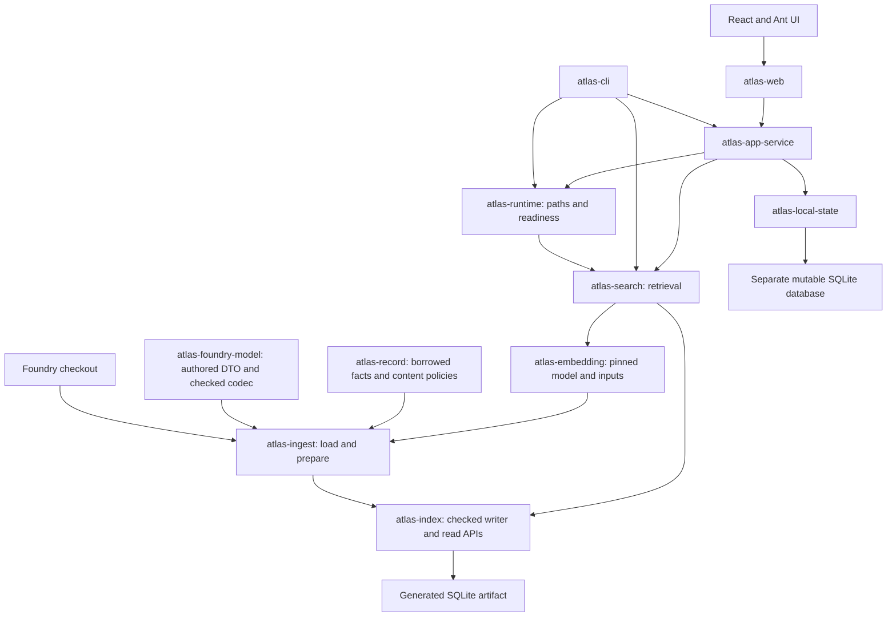

# Runtime architecture

Runtime reads use a source-backed generated artifact. Build-time admission,
filesystem discovery and developer reports remain separate from product retrieval.
See the [overview](./overview.md) for crate ownership and the
[artifact contract](./artifact-contract.md) for storage/validation.

## Source loading and checked records

Private TypeScript tooling resolves pinned Foundry declarations and emits modular
Rust under `atlas-foundry-model/src/source_model/generated`. Large extracted
graphs are ignored caches; CI regenerates/checks committed Rust. Ordinary builds
need neither Node nor the upstream checkout. Generation ownership, recursive
identity, templates and authored profiles follow ADR0034–40.

Strict authored parsing and admission are distinct. Admission retains useful
records with explicit invalid members and diagnostics; malformed collection
members are not silently dropped or reordered. Specific rule interpretation stays
atomic and separate from generic Item rule retention. See ADR0041. Ingest's
`load_foundry_documents` preserves file order, bytes/hashes, provenance and explicit
quarantines/unaddressable outcomes; it does not construct product schemas.

`SourceBackedRecord` derives a checked key from an admitted DTO and exposes an
immutable body. Its shared traversal processes borrowed nodes using an active
owner chain, rather than storing a global inventory. Consumers request concrete
owner/content addresses. Family/common query and presentation views borrow actual
typed fields and preserve unavailable states. There is no DTO-to-AtlasRecord
normalization step or separately maintained runtime family authority.

`encode_snapshot`/`decode_snapshot` belong to `atlas-foundry-model`. Decoding reads
the tagged checked representation with version/identity/recursion guards; it runs
no source admission, defaults or repairs. Original complete source JSON is not
duplicated in the artifact. Developer source inspection can read the checkout;
normal runtime reads use the checked codec and work without it.
`atlas record source` explicitly exports a product record's complete checked
snapshot and compact provenance through the existing retrieval/app-service path.
This inspection does not use presentation projections or read the source clone.
The shared model-owned JSON inspection helper preserves the codec's depth guards;
developer original-file inspection remains a separate hash-verified operation.

## Build and preparation

Ingest first establishes source/reference identity, then supplies explicit locale,
audience and resolver context to record-owned preparation and relationship policies.
The record itself remains a key and DTO. Content outcomes and resolved relationship
occurrences are separate derived outputs. Original bytes/provenance, admission
failures and detailed reports remain ingest/developer concerns.

`BuildArtifactOptions` composes source paths, locale, optional embedding config,
batching/reuse and output paths. The build produces index-owned inputs: checked
records, named typed projections, selected content, verified identity evidence and
attributed lexical/semantic units. The index writer owns physical encoding and
publication. Failures preserve the previous artifact.

The aggregate source fingerprint hashes the ordered actual relevant inputs,
including manifest/pack definitions and excluded records. A Git revision alone
does not capture exported checkouts or local edits. Preparation identity also
includes locale/catalogs, audience, content/relationship/selection policies and
exact model assets. Reuse requires compatible complete identities, not matching
record keys alone. Before accepting cached vectors, ingest reconstructs the old
selected inputs with the pinned tokenizer and verifies their stored hash, token
count and source attribution. Index remains independent of tokenizer/model assets.

The content interpreter produces sanitized HTML and narrow marker/control facts.
It uses an existing HTML parser/sanitizer rather than a persistent generic tree.
The selected cache is stored once per field; authored markup remains in the DTO.
CLI formatting is derived with html2text at read time. UI controls use field-local
ordinals and intentional app contracts, never arbitrary Foundry JavaScript.
Initial indexing includes GM/owner text/DCs and excludes None; English is the
overridable build default. Search/display initially use artifact locale.

Lexical selection uses names, verified aliases, typed vocabulary, actual owned
labels and meaningful structural definition labels. It does not dump descriptive
prose into FTS. Semantic selection independently covers selected explanatory
root/owned passages plus compact root identity. text-splitter segments passages;
the actual tokenizer checks every final input with complete body/tail coverage.
FastEmbed executes the pinned BGE-small model using CLS/L2. No custom universal
pooling, clipping, estimator fallback or model catalog alternatives remain.

## Runtime paths and setup

`AtlasRuntime` resolves global platform-cache paths by default. Explicit repo mode
requires an authenticated Atlas Git root and uses `vendor/pf2e`, `.cache/hf-models`
and `.cache/pf2e-index.sqlite`. Command-local path overrides do not persist global
configuration. The local-state path is separate from the generated artifact.

Setup owns source-fetch/offline policy, pinned model preparation, repair/rebuild
and readiness reporting. Records-only mode does not require query embeddings;
full mode does. A missing or unsupported artifact produces an actionable rebuild
result. An existing indexing locale is preserved unless explicitly overridden;
a fresh artifact defaults to English. The embedding crate owns checksum/cache
readiness through `validate_embedding_model_cache`, with no model load required.

Explicit setup freshness may compare the source fingerprint. Ordinary lookup,
search, lists and encounters do not scan the source checkout. Cheap index checks
validate the executable contract/capability; deep coherence validation is an
explicit diagnostic/build-publication operation. Model-free lexical and stored
vector workflows remain deliberate modes rather than implicit web fallbacks.

## Retrieval and application workflows

Short-lived CLI workflows lazily open one retrieval service and retain it across
all reference operations until the command ends. Semantic mode loads one query
embedder; lexical and stored-vector commands remain model-free. Source-free
local-state operations require no artifact open.

The long-running web service retains two independent retrieval workers. Startup
compares the index-owned physical instance and complete preparation identity of
every opened reader; publication during construction fails clearly when workers
opened different instances. Failed startup closes the queue and joins started
workers before returning. A running service retains its artifact until restart,
preserving bounded parallel reads while later artifacts are published.

Search pages, contextual filter counts, and both contextual and count-free value
discovery receive an explicit, non-serialized `ReadExecutionContext`. Unrelated callers
choose an uncancellable context. App-service checks abandonment before lazy open
and queue admission, before a worker enters its expensive closure, and after
completed retrieval before app projection. A canceled queued item can retain its
slot and blocking waiter until drained; the contract saves work rather than
promising immediate capacity reclamation.

Web's `call_read_service` keeps an abandonment guard in the awaiting handler
future and delegates to the existing bounded blocking-call helper. Dropping the
wait marks the context; the actual blocking closure retains its semaphore permit
until completion. Started SQL/model work can finish before reaching the next
checkpoint. This does not introduce native interruption, deadlines, or a promise
that every browser abort drops its server handler. Durable mutations, transaction
receipts and their reference reads use the normal uncancellable path under
[ADR0048](./decisions/0048-atomic-mutable-workflows.md).

`AtlasRetrievalService` is a concrete service over index plus optional query
embedder. Narrow inherent methods own strict name/key lookup, browse, text search,
similar, graph, remaster links, Suggested variants and catalog discovery. There
is no capability-trait compatibility layer or alternate old reader.

The shared predicate compiles to index-owned parameterized eligibility SQL.
CLI CEL and UI structured requests independently target it. Applicable source
fields retain value/missing/null/invalid/not-applicable states; only true matches.
Same-child Exists preserves one witness. Facets use the same bindings and explicit
self-exclusion semantics. Index analysis returns typed optional unavailability for
valid unsupported suggestion contexts before search loads embeddings or ranks
candidates. Malformed predicates, wrong targets/scopes, invalid types and bounds,
and actual model/SQLite/service failures remain errors. CLI raw discovery presents
unavailable contexts as actionable command failures without another analysis.

Count-free vocabulary is a separate discovery request with artifact or saved-list
membership scope, value-search text, bounded paging and selected literals. It has
no query predicate, query text or retrieval mode. App-service resolves saved-list
keys; search forwards scope without embedding; index enumerates known applicable
product values before edition preference. Empty membership remains empty, and
retained selections do not inflate suggestion totals. Contextual counts retain
their exact same-child/counterfactual/remaster and bounded-candidate semantics.

Index owns useful human labels alongside executable filter definitions.
App-service adds collection-context prefixes, groups, choice and operator labels
and one ordered common field list: Kind, Level / Rank, Rarity, Traits. Presentation
decoration does not declare executable fields or choices.
Editor catalog discovery is independent of active criteria and saved-list
membership. It remains available to repair invalid URL conditions. Operator
metadata includes the input shape (scalar, list, range, availability or nested
predicate); rendering and value transitions use this contract. Executable search
and contextual counts retain their separate index-owned validation.
The common Level / rank primitive is index-owned and uses existing rank/state
for spells and level/state for other applicable families.

FTS and sqlite-vec apply filters, key scopes and product eligibility before top-k.
Search aggregates matching units to one root result while preserving useful
root/owned/field/passage witnesses. Semantic scoring uses max per root, hybrid
uses one lane rank per root with RRF60, and candidate windows remain bounded.
Verified legacy preference applies only among records matching the complete request,
before paging. Exact legacy keys remain accessible. Macros are excluded on every
product path; RollTables remain browse/search/detail records.

Text search and semantic contextual discovery share an exhaustive query-embedding
error conversion. Empty input and exact token-budget overflow remain invalid
requests, with useful counts and a shortening instruction; model/cache/inference
failures retain their availability classification. Queries are never truncated or
downgraded to lexical retrieval to conceal semantic input errors. Optional facet
availability is still checked before embeddings when its context is unsupported.

Index summaries and selected cache bundles are body free. Explicit detail decodes
one root and batches required fields. Search result witnesses do not cause
per-field/per-marker body reads. Reader connections stay on one generation while
the writer atomically publishes later artifacts.

App-service search pages reuse browse, text and stored-vector Similar retrieval.
Similar mode carries the exact root seed and canonical filters, and returns a
body-free seed summary beside bounded candidate pages. It adds no ranking lane or
query embedding. Every request supplies its complete criteria, page and optional
expected artifact generation. The generation check precedes embedding and ranking;
a mismatch returns `ArtifactGenerationChanged` with HTTP409 and expected/actual
context hashes. There is no app window registry or handle lifecycle. Each page
still performs retrieval independently, including query inference where needed;
the API does not promise a frozen semantic candidate set or cache speedup.
Browser URL state owns the removable seed criterion. Similarity uses catalog
choices and vocabulary without text-scoped contextual facet counts.

The browser search owner keeps the current generation and request epoch. Query
keys include criteria, page and generation; first-response adoption reuses the
completed page without a second inference request. Generation conflicts pause
paging and offer `Refresh results`. Recovery cancels affected immutable queries
before removing their data, advances the epoch and restarts at page1 with the same
criteria. Previous-page data never crosses generations. Saved lists, encounter
aggregates and dirty drafts survive this reset. Signals and epoch checks prevent
late old reads from restoring retired data. Similar previews reload their actual
owning detail before retrying against a new generation, including encounter-owned
reference previews. Snapshot-local owner selections remain exact.

One bounded app-service Related operation returns verified nonempty categories
with separate empty, unavailable and error outcomes. Its reference scope is the
exact selected owner (including the empty root owner path). Verified counterparts
and typed variant checks apply only to roots. Variant checks retain their bounded
source-snapshot compatibility verification; category discovery never runs Similar
ranking. Responses and browser caches use the complete selection and immutable
artifact-context hash, distinct from snapshot-local navigation fingerprints.

App-service owns workflow composition/search pages, catalog-to-editor controls,
semantic family presentation and local-state hydration over runtime/search.
Detail retains a body-free root summary, full selected address, and selected-node
identity beside prepared content, useful owned links and an explicit family body.
Authored reference extraction is independent of encounter composition; the private
encounter arithmetic workspace is never transported. Encounter participants have
one composed presentation beside their durable local state, with explanations
attached to adjusted facts. Fact availability distinguishes missing, null, invalid
and not-applicable parents from known zero, false and empty collections.

Transient physical price facts retain availability for each currency, and table
results retain collection availability with one owned-link collection in the
table body. App-service supplies compact kind/level/rank captions from typed
facts. Shared readers omit optional known-empty baseline rows and empty headings
without altering source facts; required/unavailable values and explicit authored
clear/empty changes remain visible. No stored visibility flags or HTML emptiness
parser participates in this policy.

Spells and their owned copies display authored casting context, damage, fixed or
interval heightening and partial form changes. This is reference data, including
explicit clears; it does not execute casting, calculate effective forms or spend
resources. Renderers share semantic responses while independently formatting
terminal and browser layouts. Complete selected navigation drives detail caching
and reader transitions. Root terminal summaries stay body-free.

Selected immediate Actor casting entries obtain associated local spells from the
already-decoded checked parent, preserving complete owner addresses. Root activity
rosters expose base and explicit authored cast ranks without duplicating the
roster in each entry. Hazard defense-block applicability is projected explicitly:
known zero AC and maximum HP suppress the primary block while original facts and
valid zero saves remain retained. Shared reference layouts put prose first;
encounter layouts prioritize combat state. Immediate Ability-class actions, effects and feats read inline by default through
bounded owned-reading batches: one checked parent decode and one attributed
prepared-content batch, up to 32 activities and 256 fields. Index owns exact
locator SQL and complete relationship attribution for each delivered field.
Fields exceeding the 1024 occurrence response budget have an explicit bounded
outcome; valid rich content is never delivered with silently disabled links.
Separate non-content relationship discovery remains bounded. Reading continuations
and browser caches bind the immutable artifact generation; partial content never
seeds selected-detail caches. Direct late-owner landing loads its bounded range
without predecessor reads and retains explicit backward/forward continuation.

All browser reference consumers render the same family meaning, including native
previews and comparison; compact changes density only. Shared prepared content
renders authored controls and exact links. Scrolling the actual reading container
near continuation starts the next finite batch; an idle visible sentinel and a
collapsed section do not start further batches. Complete checked owner anchors
are distinct from selected-detail addresses. Native permalinks preserve modified
clicks, and parent return retains known search/list/reader context and a checked
reading landing.

Encounter quick lookup requests the same complete selected-document view as other
reference readers. App-service checks the participant against current local state,
decodes one checked parent, reads selected content and composes the bounded runtime
overlay in Rust. Casting entries retain their associated local spell roster;
equipment keeps its customized authored view. Spells retain full authored details
and current runtime notes without calculating spell forms or damage adjustments.
Runtime detail uses a separate cache keyed by participant presentation and complete
selection; it never seeds immutable reference caches. Changed participants, stale
generations and missing selections remain explicit. Content-free
hydration captures the artifact generation in the same deduplicated retrieval;
source-free encounters have no generation and require no artifact open. Invalid
referenced participants remain unresolved rather than becoming manual records.

An embedded reader can offer an Original record link only for a resolved explicit
CompendiumProvenance relationship. It opens the current local catalog record,
while the selected reader and its full-page permalink retain the embedded copy.
There is no name-based pairing or substitution of catalog data into local copies.

Web startup uses
full pooled retrieval; short-lived CLI workflows may choose explicit model-free
or stored-vector modes. The bounded executor prevents one global serialized lane.
Web routes are transport glue. App-model generates intentional browser DTOs;
the browser neither receives whole Foundry bodies nor reimplements gameplay rules.

Web hosting embeds the built frontend into debug and release binaries. A running
server retains its compiled frontend/backend pair when later builds change the
checkout's frontend output. Frontend hot reload uses the separate Vite dev server.

Saved lists/encounters preserve unresolved snapshots and explicit user choices.
Actor display uses authored baselines with bounded source/participant/condition
overlays and unapplied-context notes. New HP starts from a known integral effective
maximum; unknown does not become zero. Source adjustments apply once, explicit
participant choices replace them, and saved HP/overrides/edit intent survive
artifact rebuilds. No Foundry world execution or guessed aggregate mechanics is
introduced. Local-state migrations preserve existing ambiguous values.

Local-state initialization and migrations commit schema and metadata together.
List metadata/tags, quantity additions and removal with replacement turn each
have one write transaction. Next turn chooses from the same locked snapshot it
updates, using pure app-service policy. Participant replacements require an
expected revision and fail with a typed conflict when stale. Condition IDs are
not reused, and condition edits check participant ownership inside the write.
Existing-encounter mutations return a durable canonical-key receipt rather than
hydrating reference presentation after commit. Saved-list import uses its
precommit resolved summaries for receipt counts. Explicit reads own any later
projection failure. These boundaries are defined by
[ADR0048](./decisions/0048-atomic-mutable-workflows.md).

The browser's detail/edit mutation owner serializes commands through their
canonical-key refresh and populates the route alias from the same response.
There is no private optimistic participant overlay. A failed refresh after a
receipt is a saved-but-unavailable state with read-only Retry, not a failed
write. Typed stale conflicts retain the draft and refresh without resubmission.
Save and deletion confirmations await completion; same-entity dirty metadata
survives background refresh and old route completions cannot navigate a new
editor. The index owns its separate awaited deletion and action-local feedback.

## Deferred work

New query projections are added only for useful product cases, with typed bindings,
catalog/SQL/facet evidence and consumer tests. Skills, nuanced affliction filters,
frequency/aggregate gameplay models and tag-artifact search are deferred. Tag-file
validation remains independent; HasMetric is explicitly unsupported rather than
recreating a metric store.

Macro-inspired UI actions, source-local asset ingestion, independent runtime display
locale, broader label selection, representative root embeddings/reranking and new
embedding models require separate bounded design/evidence. Their retained source
data does not imply runtime execution support. See the active backlog and ADR0046.
