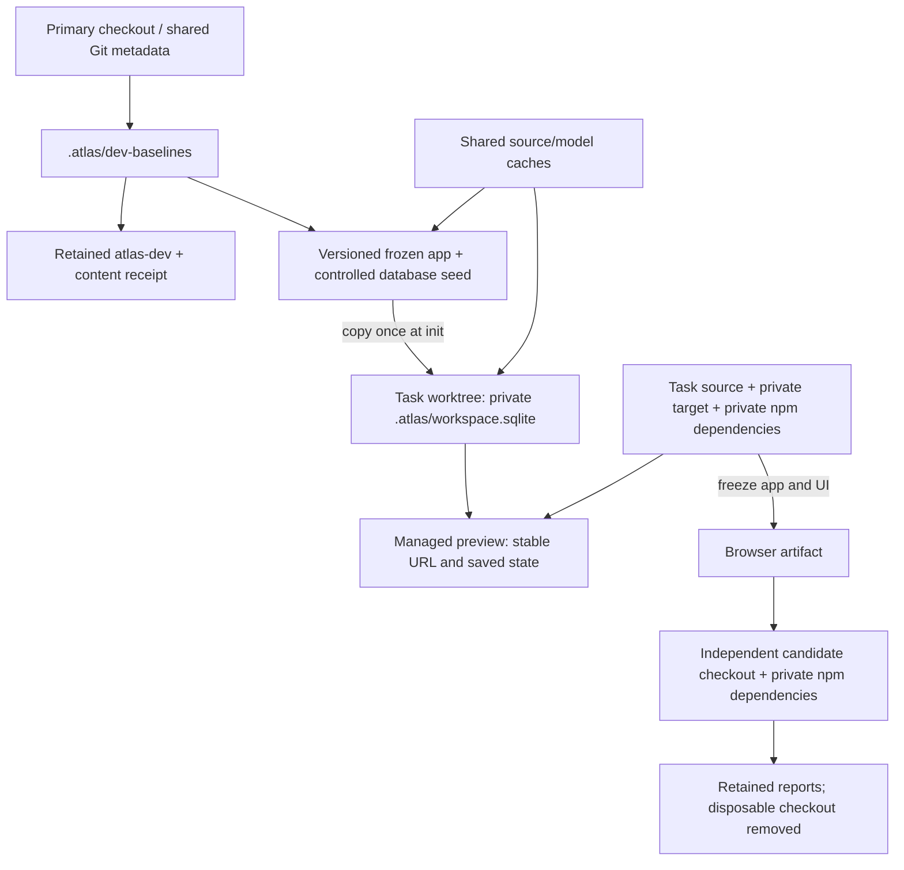

# Development setup and previews

Run commands from the repository root. Read this guide when preparing a checkout,
selecting a development backend, or sharing and refreshing a human preview.

## Checkout setup

Use the pinned Rust toolchain and Node 22.18+ in the 22.x line (the frontend's
`.node-version`, matching CI), or the supported Node 24.x line. Check
`rustc --version` and `node --version` before gates; do not inherit an arbitrary
global runtime. Frontend npm metadata enforces these Node lines on installation.
The supported Node versions also provide native type stripping for contributor
TypeScript tools. Install frontend dependencies with `npm --prefix web/atlas-ui ci`;
keep their lockfile consistent and use private dependencies for isolated runs.

Use `just preflight --validation` for Cargo readiness or `just preflight --preview`
for a managed preview. Actual operations also check their selected prerequisites
before expensive work. Checks probe versions and offline metadata; they never
install dependencies/toolchains, rebuild, or migrate data. Version probes set
`RUSTUP_AUTO_INSTALL=0`. Custom `RUSTC`/`CARGO_BUILD_RUSTC` or Cargo `rustc`
selectors are rejected with a repair hint rather than checking a different
compiler from Cargo's selection. Supported wrappers/flags are fingerprinted.

Install tracked git hooks and verify this checkout:

```bash
scripts/install-git-hooks.sh
scripts/preflight.sh
# or: just dev-setup
```

Use Cargo's default `target/` directory inside each checkout, including linked
worktrees. Compiled tests embed checkout-specific fixture paths, so sharing a
`CARGO_TARGET_DIR` across worktrees can reuse binaries with stale paths. Run
`git push` directly; no Cargo environment override is needed.

## Reusable Development Baseline

The existing Rust `atlas-dev` tool owns the baseline workflow. On macOS or Linux,
run `just dev-tool-build` once from a checkout containing this tooling. It uses the
normal Cargo build and retains the executable under the primary checkout at
`.atlas/dev-baselines/tools/atlas-dev`. Subsequent init/status/web commands need
no Rust build or Python runtime, even from a new worktree.

Refresh with `just dev-tool-build` after changing its Rust inputs or when readiness
reports an obsolete capability or receipt. The retained binary has a content-based
receipt covering local crate dependencies, assets, Cargo configuration and compiler
environment. A commit alone does not invalidate it; a mismatched binary/receipt
fails closed. Refreshing replaces only the retained developer tool;
it does not change baseline executables, manifests, data, or existing previews.
`ATLAS_DEV_BINARY=/absolute/path/to/atlas-dev` explicitly selects a candidate
developer tool for the thin shell launchers. The selected Atlas app executable
is a separate choice controlled by `--binary`.

After a validated build changes schema, baseline support or developer capabilities,
refresh the shared default explicitly:

```sh
just dev-tool-build
just dev-build --profile release  # clean committed, validated candidate; reuses verified UI
just dev-shared-refresh
```

Shared refresh freezes verified app/tool copies and a clean source checkout,
initializes a private database from the current controlled seed, runs offline setup there, then calls
the existing Rust deep-validation/publication owner. It reuses shared source/model
assets and publishes the atomic current pointer only after validation succeeds.
It never stages from a task or installed personal database. Existing task receipts
remain pinned; an old seed is advisory, not proof that a private database is stale.
Run this at a relevant completed/merged milestone, not after ordinary UI edits.

Maintenance defaults to the optimized release build and requires its matching
`.atlas/maintenance-build.json` receipt. It never builds or falls back implicitly.
For an explicit dev-build investigation, pair `just dev-build --profile dev`
with `just dev-shared-refresh --profile dev`. Ordinary `dev-build` and managed
previews still default to dev and use `.atlas/preview-build.json`. Both receipts
bind the selected profile, source and executable checksum. Release compilation
has an initial cost; reuse it across maintenance operations with unchanged inputs.
Dev builds optimize the stable SHA-256 dependency while workspace code retains
normal incremental compilation.

After “Maintenance candidate frozen,” source edits may resume while maintenance
uses its pinned checkout and executables. Keep the caller checkout present until
publication finishes: it still locates the shared Git store and checks asset
lifetimes. Validation logs remain under the caller's `.atlas/validation` (or
`ATLAS_VALIDATION_OUTPUT_ROOT`), even after the temporary checkout is removed.

All linked worktrees resolve one shared store through Git's common directory:
`<primary-checkout>/.atlas/dev-baselines`. `--store /absolute/path` overrides it.
The store contains versioned executable/database pairs and an atomic `current.json`
pointer. It is development data, not disposable compiler output.



Compiler output and `node_modules` stay private to a checkout. Shared assets,
retained tool and immutable seed versions are deliberate reusable artifacts.

Publish an existing build whose provenance you know, after its normal code checks.
Publishing performs a consistent SQLite backup, checks Atlas readiness, runs deep
artifact validation and executes a vector query with every configured profile.
Progress names the executable copy, database snapshot and checksum, reference
validation, and each profile's model loading and test search. These checks can
take several minutes on a full corpus. Use `--progress always` for progress in
redirected logs; `--json` keeps the final report on stdout.
It does not compile, fetch models, migrate, or ingest. The source workspace must
already be ready. **All saved state is copied**: use a dedicated development seed
with controlled examples, not your personal installed workspace.

```sh
just dev-baseline-publish --binary target/release/atlas \
  --build-commit HEAD --build-profile release --toolchain 1.95.0 \
  --index .atlas/workspace.sqlite \
  --source /absolute/shared/pf2e/PINNED_COMMIT \
  --embedding-cache-path /absolute/shared/hf-models
```

The commit, toolchain and profile are publisher-declared build provenance; the
command cannot infer them from an arbitrary binary. Use the actual build commit,
not current HEAD if the executable is older. The manifest also records the copied
binary hash/version, database hash, schema version, source/contract context,
embedding profiles and validation reports. Default asset resolution uses global
paths; explicit source and model paths must survive worktree retirement. Publication
rejects assets inside registered linked worktrees. Neither Cargo targets nor the
installed personal executable are overwritten.

For main or a new worktree:

```sh
just dev-workspace-init
just dev-status
just dev-web --port 4727
# Frontend-only work: point this checkout's Vite server at that backend.
ATLAS_API_PROXY=http://127.0.0.1:4727 npm --prefix web/atlas-ui run dev
```

Initialization copies the current seed into `.atlas/workspace.sqlite`, records
its baseline in `.atlas/dev-workspace.json`, and never replaces existing data or
receipts. On macOS it attempts an APFS clone, falling back to a regular copy.
Each database has independent mutable pages and stable Atlas lock files. An
existing database without a receipt is preserved, not adopted or reset.
New workspaces reuse the prepared reference data and embeddings; initialization
does not run setup or require `--force`. Publish optimized release executables for
shared baselines so build-free commands also get release runtime performance.

`dev-status` and `dev-web` default to the frozen baseline executable. They do not
claim to run the current checkout's code. For Rust changes, build in the checkout's
own warm `target/`, then select that executable explicitly:

```sh
cargo build --locked -p atlas-cli
just dev-status --binary target/debug/atlas
just dev-web --binary target/debug/atlas --port 4827
```

`dev-status --json` includes the complete manifest and check reports.
Its compatibility result describes the selected executable and database, not the
current frontend. Vite and the backend also compare an automatically derived API
fingerprint before the browser opens a feature page. An October baseline can be
healthy with its own frozen executable while incompatible with today's Vite UI.
If the browser reports “Atlas versions don’t match,” check `ATLAS_API_PROXY`, build
the current frontend with `just web-ui-build`, build the matching backend, then
select it explicitly with `dev-web --binary`. Retry the page after restarting.
Old backends without the handshake are rejected too.
Installed frontends automatically reload once if startup detects a mismatch; a
persistent mismatch stops with Reload page. During use, an update prompt preserves
the mounted page and drafts until the user reloads. Neither recovery path replays
mutations or clears browser caches. Vite shows the proxy/backend diagnostic without
an automatic reload.

The wire fingerprint hashes the generated TypeScript bindings and explicit
`protocol_revision` in `crates/atlas-web/api-contract.json`. Rust and Vite use
identical framing, ordering and line-ending normalization. Internal Rust
implementation, tests and comments do not change it. Generated binding changes
remain conservative invalidations, including generated documentation comments.
Cargo rejects stale `dist/api-contract.txt`; Vite watches contract inputs.

For route, transport, serde omission/null/default, encoding or protocol changes
that TypeScript cannot express, bump `protocol_revision` and add behavioral
regressions. Generated types alone cannot prove those semantics. UI-only changes
can reuse a compatible backend, regardless of its Git commit. Compatibility does
not establish freshness: a frozen compatible backend still runs its frozen rules.
Use selected executable/build provenance to verify which implementation is served.
See
[ADR0029](../architecture/decisions/0029-local-web-app-boundary.md#browserbackend-compatibility)
for revision ownership, compatibility limits and the request guard.

Status invokes read-only Atlas checks and prints a fully qualified setup command
when a candidate needs migration or a reference update. It exits nonzero for
incompatible/unready data. Run that setup command deliberately against the private
copy; failed readiness never triggers an automatic rebuild. Setup can reuse
compatible saved embeddings. `--binary` may point to `target/debug-full/atlas` for
full debugger symbols or a release build for indexing/inference performance.

Each working copy stays pinned to its original seed even after a new default is
published. Initialization accepts `--baseline ID` to select an older version for
a new workspace. Existing lists/encounters must be preserved through normal
setup; there is intentionally no overwrite/reset flag. Do not point the web app
at the immutable seed itself, or hard-link writable SQLite databases. Seeds retain
the copied workspace identity; use separate ports for concurrently active tasks,
reuse each task's URL across revisions, and do not exchange saved-state generations
between divergent copies.

Publish new baseline versions when a validated main build or data-contract change
makes one useful; ordinary presentation edits need no data rebuild. Retain the
main Cargo target for incremental work. Parallel Rust branches still compile
locally; a baseline executable serves branches that do not need backend changes.
Keep baseline versions referenced by `.atlas/dev-workspace.json` or running
processes. Retire unused versions only after checking those dependencies and any
saved state. Existing previews never follow the moving default automatically.

The commands can be tried before merge from another checkout with
`just --justfile /absolute/path/to/task/justfile dev-status`; they operate on the
invoking checkout. `--checkout /absolute/path` selects a different checkout.
`just dev-baseline-test` runs the focused snapshot/publication/isolation tests
without models. The same tests run in the existing Rust workspace CI gate.

## Managed candidate previews

For a built candidate that needs repeatable refresh, use the managed preview
workflow. Explicitly refresh the retained developer tool once after its source
changes; normal baseline commands continue to use it without compilation:

```bash
just dev-tool-build
just dev-workspace-init
just dev-preview --port 4827
```

Start stays in the foreground as the owning supervisor. From another terminal
in the same checkout, use:

```bash
just dev-refresh
just dev-status --binary target/debug/atlas --json
just dev-preview-stop
```

`dev-preview` and `dev-refresh` default to the dev profile for incremental code
iteration. For a runtime performance check or an ingest-heavy preview, select an
optimized build of the current checkout with a leading `--profile release`:

```bash
just dev-preview --profile release --port 4827
# From another terminal in the same checkout:
just dev-refresh --profile release
just dev-status --binary target/release/atlas --json
```

Specify the profile before server options and repeat it on each refresh; omitting
it selects dev, even when the running server uses release. `--profile dev` switches
back explicitly. Release selects compiler optimizations, not a different branch
or workspace. Unit tests retain their normal profiles. For bulk setup against a
private workspace, build with `just dev-build --profile release` and use that
executable for the deliberate setup command reported by status.

Both commands build the selected candidate before replacing a server and pass its
matching binary and provenance receipt to the same supervisor.
The shared frontend build receipt verifies current production inputs, API identity
and every output checksum. Rust-only, frontend test and documentation edits can
reuse that bundle; UI/contract changes or tampered assets rebuild it. Cargo reuses
the checkout's warm target. This explicit build workflow requires Node and Cargo;
plain `dev-web`, status and workspace initialization remain build-free.

The Rust baseline owner retains the live child and a frozen executable for
fallback; a PID receipt never authorizes killing another process. Refresh reuses
the active port, private database and source/model selection, serializes requests,
checks the candidate's index contract, then verifies served readiness for every
stored profile and the expected UI bytes. Web startup authenticates the migration
ledger. Initial startup checks the actual server; an unchanged executable/UI
refresh checks the existing live child without starting another web process. A changed
candidate first starts on a private probe port. The probe is stopped and reaped
before replacing the current server at its stable URL. Probe diagnostics live in
`.atlas/dev-preview/probe.log`; rejection leaves the current server log intact.

Index checks and each startup have bounded 20-second budgets. The control request
budget includes one index check, probe, replacement and fallback startup, plus
shutdown margin. Cancellation continues to poll during checks and startup.
Compilation, index or probe failure preserves the current server; replacement
failure attempts to restore the previous frozen executable and reports failure.
Incompatible data requires deliberate normal setup, never an automatic
migration/reset, baseline republication or corpus copy.

Preview admission checks whether the published workspace can be served. Full
`setup --check` separately checks requested setup intent and source freshness;
for example, a pending profile request may coexist with a usable published
workspace. It is not repeated on refresh. Within one setup check, verified model
assets are reused across report sections while file metadata still detects
replacement or repair. `ATLAS_LOG=info` includes elapsed times for model
verification and source freshness.

`dev-status --json` separates `baseline_build` from the selected binary checksum
and `managed_preview` state. `.atlas/dev-preview/status.json` identifies the URL,
workspace, selected snapshot, source receipt and log. `.atlas/preview-build.json`
(dev) or `.atlas/maintenance-build.json` (release) binds recorded source/input
identity to binary/UI checksums and toolchain; source
changes during compilation reject it. A commit-only move with identical inputs
records both observed commits. A manually supplied binary without a build receipt
has checksums but unknown source provenance. Compatibility alone proves neither
freshness nor source identity.

For frontend-only iteration, Vite against a compatible running backend remains
the fastest preview path. It avoids rebuilding an embedded Rust server for every
UI edit. Retain one user-visible preview URL and its review state across both
development and final built-candidate checks.

## Local Build Review

Substantive UI work gets an early human checkpoint once the core flow works.
Run the compilation and focused checks needed for a usable preview, identify
unfinished behavior and validation gaps, then get feedback before broad test
rewrites and final validation. Keep existing tests intact. Internal refactors,
backend-only work and minimal UI changes can skip this early checkpoint or share
a later preview. An unrelated CLI change does not require a browser preview.
Required final checks and independent pre-PR review still apply.

Use one published localhost URL per active task. Keep that URL across iterations
and related follow-ups, and tell the user which branch/commit it now serves, including uncommitted
differences and sample-data limitations. Build a replacement before switching the
preview; replace its served build deliberately and verify readiness at the same
URL. Reuse the task workspace so lists, encounters and other review edits carry
forward. Do not reset saved state to publish a new preview.

For example, after feedback on a spell, update the existing preview and reuse its
backend when the frontend is the only change. Creating another numbered preview,
port and full database copy for each revision is not the default. A backend or
schema change normally replaces the task backend and uses the supported workspace
migration; it does not require preserving every earlier version.

Keep an additional frozen build only for an explicitly requested comparison or a
bounded investigation that needs it. Record its purpose and removal milestone in
the current task plan, then retire its processes and disposable copies when that
purpose ends. A preview left running by the agent does not by itself establish an
active review or a reason to retain it. Automated browser fixtures remain separate,
temporary resources with their own cleanup lifecycle.

Human UI previews use a compatible full-corpus development workspace and shared
verified model cache, with every configured profile usable. Reference data and
saved state live in one SQLite file. Reuse an existing development backend for
frontend-only work when shared preview state is acceptable; otherwise seed a
private workspace with `just dev-workspace-init`. Do not attach a candidate to
the installed personal workspace. Use Vite against the selected backend for hot
reload. The model-free browser fixture is for automated acceptance and targeted
fault checks, not the human product preview. See the baseline workflow above.

UI changes require interaction and visual review alongside automated checks. Agents use Astra sub-agents for presentation review, including actual browser inspection. Local validation, hosted CI, and human acceptance are separate outcomes; a passing gate does not establish visual acceptance.

## Running the product locally

The Rust web server embeds the built frontend in both debug and release binaries.
Build the frontend before compiling a preview binary, then keep that binary and
its reference artifact fixed while they are under review. Later frontend builds
do not update a running Rust server; restart it with the new binary intentionally.
Use the Vite dev server when frontend hot reload is wanted.

For compiler/test gates and quiet/verbose output, see
[validation](validation.md#local-rust-gate).

Run the CLI from source:

```bash
cargo run -p atlas-cli -- --help
cargo run -p atlas-cli -- setup --check --json
cargo run -p atlas-cli -- search "low level healing spell" --kind spell --limit 5
```

Install the CLI from this clone:

```bash
cargo install --path crates/atlas-cli --locked
# or: just install
```

Generate shell completions:

```bash
atlas completions zsh
atlas completions bash
atlas completions fish
```

## Avoiding repeated work

For frontend-only iterations, reuse a compatible backend and Vite hot reload.
Build a new backend only when its inputs change. Initialize a workspace only when
one is missing; do not republish the full validated baseline or copy the corpus
for every UI revision. Keep one warm checkout-local Cargo target. Check matching
frontend/backend compatibility before presenting the preview. Use `just dev-refresh`
for a deliberate build and managed replacement; source edits do not trigger a
background refresh automatically. Follow the [cleanup policy](worktrees-and-cleanup.md)
when retiring the task.
