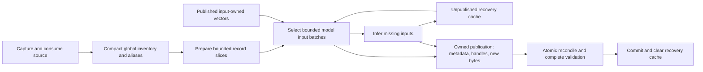

# Ingest revision: stable values and bounded preparation

The revised design separates a record occurrence from the numerical input it
uses. One exact model/input owns one searchable vector; document occurrences and
ordered trait chunks refer to it. This removes the need to preserve an entire
corpus of reused vectors before changing occurrence slots. A simpler recovery
cache and preparation pipeline address separate costs. The first checkpoint also
bundles the owned API, cache and capture changes: comparing checkpoints is not a
factorial experiment isolating numerical normalization.

[ADR0065](../architecture/decisions/0065-input-owned-reference-publication.md)
owns the decision and relationship diagram. The [runtime](../architecture/runtime.md)
and [artifact contract](../architecture/artifact-contract.md#native-embedding-storage)
own current behavior. The earlier [ingest findings](database-ingest-simplification.md)
and [ownership study](embedding-value-ownership.md) remain historical evidence.

## What changed

An input now retains its numerical identity when occurrences move or disappear.
Only selected new, forced or cache-hit values require owned numerical staging;
reused published values remain input/checksum handles until the final transaction.
A forced result can replace the bytes for the same input, so selection binds the
checksum too. Publication installs those selected bytes before reconciling all
consumers, preserves ordered/repeated trait weights, and reclaims obsolete inputs
only after their consumers are settled.

One `PreparedPublication` owns the expected workspace generation, captured
inventory/context, prepared metadata and selected values. Its private interfaces
maintain their relationship. Consumption still checks frame bounds and checksums,
vector geometry and actual stored data. Repeated authentication of unrelated
whole temporary files and durable build-target membership have been removed.

The recovery cache holds one unpublished result per complete model/input key.
Bounded inference batches contain at most 128 outputs; each batch is saved to the
cache and owned staging, then released. Oldest-first eviction has a 1 GiB logical
vector-payload backstop. Eviction can cost recomputation but cannot invalidate
owned staging. Successful complete source publication clears the cache atomically;
failed publication retains useful committed results. Metadata-only upgrades
preserve them. One update-owned attempt directory groups Atlas's explicit staging
files and supports ordinary/error/orphan cleanup through existing update ownership.

Source capture fixes the input set. Each external file is checked against its
captured hash when consumed, then becomes owned data. This includes manifests,
catalogs and pack bindings. Later edits belong to the next build, so publication
has no final source rescan. A missing or unreadable declared pack still fails;
a successfully read empty pack and deliberate declaration removal remain valid.

Preparation retains compact global identity/reference knowledge. One raw indexed
admission stream replaces per-pack streams and per-frame compression. An early
pass prepares the active alias journals, then 32-record slices combine content,
selection, lexical and passage preparation. Model keys are immutable and registry
IDs are scoped to the session or transaction that admitted them. This eliminates
repeated rich-record replay and model binding without changing input recipes.

This remains a real rebuild with complete final transactional validation. A
maintenance window is allowed; atomic publication and saved-state preservation
remain required. Ordinary startup and reads perform no cleanup or inference.

## One release, coherent migrations

The revised branch integrated main `f76232c8` at schema 24. Published migrations
1–24 retain their SQL, checksums and transitive callback behavior. The unreleased
suffix describes five final transformations directly from main:

| Version | Transformation | Reason for a separate step |
| --- | --- | --- |
| 25 | Saved-state enum and encounter-membership integrity | A saved-domain reconstruction with its own invalid-history rollback contract. |
| 26 | Lifetime turn receipts and one current outgoing snapshot | Separates durable request identity from replaceable review context. |
| 27 | Input-owned native vectors and simple recovery cache | A numerical conversion requiring exact old/new coverage and byte checks. |
| 28 | Canonical selected sections | A reference projection backfill that can use the converted native layout. |
| 29 | Closed component reconciliation | Attests final projected components and supplies supporting indexes. |

These are reviewable ownership and transformation boundaries, rather than user
release boundaries. All pending steps execute in one existing upgrade transaction
with a consistent backup. No step creates a target-history schema for a later
step to reverse. Numerical conversion precedes the section backfill; it needs no
inference or source/model assets. Experimental ledgers from an earlier version of
this unmerged PR are not supported upgrade inputs.

Released migration 20 has an explicit main-era context decoder, classifier and
admission owner. It preserves strict unknown-field rejection, classifier branch
order, old `semantic_vectors_*` validation and the released catalog/profile rules.
PR-only `selected_sections_recipe` or `admission` fields are rejected, rather than
being interpreted through current schema29 policy. Eight focused historical-
admission tests passed, including four 19→20-only tests and 14 corruption/rollback
variants, with the semantic catalog v8 digest pinned.
This preserves the released callback's contract without changing its SQL, name,
backfill ID or checksum, or adding a migration to the 25–29 suffix.

## Observations and attribution

The cached-build rows below are completed normal release CLI processes with
omitted profile/force flags and both requested profiles. They reported zero
inference and 323,022 reused inputs. Rows through `868b7e26` use the original
source; the latest `a7f837c9` retry uses the exact Heal-edited source after checked
recovery. Its fresh post-run validator/oracle preservation proof passed. The corpus
has 29,894 roots, 323,470 document occurrences and 1,586 ordered trait chunks.
The main control uses frozen `d7187e78`; its ingest/Rust/schema inputs match the
integrated main `f76232c8`, whose differences are frontend-only.

| Candidate and starting state | Wall seconds | User / system seconds | Peak process RSS |
| --- | ---: | ---: | ---: |
| Historical main `d7187e78` | 241.94 | 185.95 / 59.31 | 5.57 GiB |
| Historical pre-revision PR `c1387b92`, attested | 518.44 | 372.71 / 122.25 | 0.94 GiB |
| Fresh main control `d7187e78` | 319.59 | 224.28 / 71.76 | 4.53 GiB |
| Ownership checkpoint `ab016047`, first after upgrade, unattested | 451.48 | 332.25 / 111.76 | 0.94 GiB |
| Ownership checkpoint `ab016047`, steady attested | 424.62 | 300.27 / 110.19 | 0.89 GiB |
| Measured preparation/session and validation-plan checkpoint `868b7e26`, attested | 292.92 | 237.06 / 41.88 | 0.83 GiB |
| Latest `a7f837c9`, cached Heal-source retry after checked recovery | 355.95 | 265.52 / 48.86 | 0.86 GiB |

R1's first rebuild started without component attestations, created 29,894 and
passed complete shipping validation, exact metadata/saved comparison and an
independent native audit of 323,022 unchanged inputs. Its 324.45-second audit is
outside ingest timing. Steady started with those attestations and passed fresh
complete validation plus exact registry/consumer/saved equality, anchored to the
first audit; it is a dependent cryptographic byte proof rather than a second
independent numerical capture. Both left no pending results. First and steady
costs therefore remain separate.

The original-source `868b7e26` cached rebuild completed in 292.924108 seconds, reported zero inference
and 323,022 reused inputs, and advanced reference revision 12→13 with the raw
context unchanged. Fresh complete CLI validation passed in a separate 62.419096
seconds; the strict full29 metadata oracle reported zero changes. The independent
optimized native audit also passed: 323,022 equal inputs and zero added/changed/
removed, with exact model/input/token identities, freshly verified byte SHA and
consumer multiplicities. Its separate 237.60-second diagnostic time is outside
shipping ingest. The complete cached closeout passed; logical associations,
ordered traits, sections and saved rows are checked by the separate metadata oracle.

The latest cached retry on `a7f837c9`/shipping `4d994a24…` completed in
355.953198209 seconds (265.517137 user/48.858643 system), with 922,664,960-byte
peak RSS (0.86 GiB), zero inference and 323,022 reused inputs. Its reconciliation
diagnostic reported zero affected rows and zero root replacements. This is the
Heal-source retry after checked recovery, not an original-source repeat of the
292.92-second observation. Fresh complete validation passed separately in
81.957009834 seconds, with 2,041,298,944-byte peak RSS. The strict oracle found
exact metadata, physical rows, native registry/consumer identities, saved rows,
sections, traits and centroids, with raw context unchanged and reference revision
advanced exactly once to 15. Maintenance was clear and pending values were zero.

The fresh main control is slower than its historical observation. The private
source copy's Git index refreshed during that first control; OS/model caches and
host activity were uncontrolled. These serial single-host observations are not a
randomized benchmark. The revised candidate must be compared with the fresh
control as well as the historical regression, rather than silently retaining the
faster historical denominator. The original-source `868b7e26` observation uses
43.5% less wall time than the historical 518.44-second PR candidate, 31.0% less
than R1 steady, and 8.3% less than the fresh main control; it remains about 21%
above historical main. The latest `a7f837c9` Heal-source retry is 31.3% below that
old PR observation, but 11.4% above fresh main and 47.1% above historical main.
These are descriptive single observations with different source contexts,
executables, ordering and uncontrolled OS caches. They establish no universal
speedup, statistical claim or isolated numerical-ownership/query benefit.

The original-source 292.92-second CLI is the frozen normal release at `868b7e26`, code input
`a8ba279b203a62afe00296a8b7f36ac55964f47dcc22b64505f49be10b4fd594`, SHA256
`3f26a95f5fc77300bedc5c2718c09e51003c385081e03cfecf7b0bec1ee3df18`.
It uses default+web, opt3, storage diagnostics disabled and rusqlite without trace.
The separately frozen diagnostic driver (`01fc94a0…`) and optimized native probe
(`4868c336…`) are different tools; their timing is excluded from the CLI result.
The later source `a7f837c9`, code input
`3452d86f634fbdd72e0833785d25c22b1202c3b02cb06da6d4b86972eb96abd7`,
adds the released migration20 contract owner. Current29 publication is unchanged;
main24→29 skips migration20 and fresh migration20 has no stored context. These
facts support bounded behavioral reuse, but do not relabel the 292.92-second
observation as a measurement of a newly linked executable. Refreshed normal
shipping SHA256 `4d994a2445fd3b8e4c0d5f4ef43da290c5410ec0936eba6aa893127109c9514f`
and diagnostic SHA256 `78491a22e9800c98fe4ec1d870031bd91558140b44bdafeb8ab77a85a98929ca`
are frozen at `a7f837c9`/code `3452d86f…`. The normal build has default+web,
storage diagnostics disabled and rusqlite without trace; the driver enables its
separate diagnostics/trace features. The optimized native probe remains the
unchanged `4868c336…` binary, with exact source/schema/four extern identities and
eight synthetic fixtures supporting reuse. The refreshed shipping executable's
cached observation is the Heal-source retry above; the older original-source
timing retains its own executable and context identity.

The normal metadata upgrade at the ownership checkpoint took 587.41 seconds in
the diagnostic API process, with 0.39 GiB peak RSS. Its separate product validation
took 106.30 seconds. These are upgrade and validation observations, not shipping
cached-build times. A literal native comparison checked every original document
occurrence, ordered trait consumer and centroid against main24 bytes. Saved rows,
high-water counters, occurrence associations and the released ledger prefix also
matched. The only approved context change was the section recipe marker.

The upgrade backup independently passed main24 validation and exact logical,
saved/context and physical-row comparison. Its standalone DELETE-journal
representation need not have the source file's whole-file SHA.

Observed owner wall times differed across these cached cohorts:

| Owner phase | R1 steady seconds | `868b7e26` original source | `a7f837c9` Heal-source retry |
| --- | ---: | ---: | ---: |
| Source preparation | 111.68 | 76.27 | 86.10 |
| All-profile descriptor prevalidation | 59.96 | 45.41 | 58.76 |
| Bounded native selection/execution, both profiles | 28.17 | 22.80 | 28.23 |
| Reconciliation and pruning | 61.13 | 52.78 | 52.39 |
| Complete publication validation | 153.84 | 88.91 | 123.12 |

At `868b7e26`, exclusive publication was 143.00 seconds and contains installation,
reconciliation and final validation; nested phases must not be added twice.
The reconciliation diagnostic reported zero affected rows and zero snapshot,
query, content or relationship root replacements. This remains a real rebuild
with full final validation, rather than a skipped setup operation.

The staged numerical payload was zero for published reuse, while the selection
SQLite file was 27,029,504 bytes. The raw metadata frames trade compression work
for temporary disk use: the measured admission/publication overlap observed
1,823,052,475 file bytes and 1,850,220,544 stat-allocated bytes. The later owned
metadata/staged boundary observed 1,399,500,632 and 1,432,686,592 bytes respectively,
versus 556,671,764 and 593,252,352 at R1's first owned-staging boundary. These are
phase-boundary observations, not exclusive peak-space measurements.

A subsequent plan-only probe showed both profiles' native validator queries
carrying complete vector BLOBs into an ORDER BY sorter. The final candidate adds
`i NOT INDEXED` so it filters registry metadata and streams native lookups in
input-ID order. All joins, geometry guards, checksums, coverage checks and ordering
remain; the actual VDBE establishes sorter removal. The final comparison includes
preparation/session changes and this validation execution-plan correction, rather
than preparation alone. The publication-validation observations were 88.91 seconds
at `868b7e26` and 123.12 seconds in the latest `a7f837c9` retry. Their difference
does not isolate an execution-plan, source-context or cache effect.

Phase wall is distinct from whole-process CPU. No per-phase CPU/RSS, exclusive
disk allocation, logical write count or continuously observed admission downtime
has been established by the shipping runner. No causal percentage is assigned
to an individual mechanism.

## Retrieval and validation

Input ownership changes native eligibility translation and occurrence expansion.
Eligibility still applies before KNN; only eligible occurrences expand and the
result is capped to the existing occurrence budget. Core, exclusions, Similar
roles/correspondence and attribution remain explicit. Exact cutoff ties may choose
different witnesses. The earlier 192-case SQL prototype was slower, so numerical
normalization alone does not establish a search speedup or relevance improvement.

The exact private Heal edit passed its complete source-change proof on
`a7f837c9`/shipping `4d994a24…`. The build took 317.620042791 seconds
(250.646759 user/45.301111 system), inferred one input per profile and reused
323,020 total, with 4,308,992,000-byte peak RSS (4.01 GiB). Publication advanced
reference revision 13→14 and left no pending results. Full validation by the same
shipping binary passed separately in 65.388114167 seconds. The independent native
audit took 313.505605 seconds outside ingest timing; the exact predeclared delta
comparison found 323,020 retained inputs unchanged, two old inputs removed and
two new inputs added.

Only `spells-srd:rfZpqmj0AIIdkVIs` changed among 29,894 roots; the other 29,893
roots remained byte-equal. All 22 saved tables, high-water counters, stable
identities, profiles, trait memberships/ordered chunks and centroids were retained.
The 784 global trait-definition changes were restricted to the exact raw
`source_revision` token transition and its checked definition hashes. Heal's
record ID and complete physical lexical array remained exact. A scoped physical-
row waiver covers that single changed Heal row, subordinate to the independent
logical proof, exact native delta and complete validator; it is not a claim that
only allocation IDs changed.

The diagnostic interruption exited 72 after 178.583805625 seconds with the exact
reference-14 marker. Owning checked recovery completed in 88.218236042 seconds;
fresh complete validation then passed in 66.720469583 seconds. Exact logical and
physical comparison retained the audited Heal publication at revision 14,
including its main-file SHA, raw context, saved/high-water and native registry/
consumer state, while clearing maintenance. The subsequent normal cached retry
and its preservation proof are recorded above. Normal product ownership reclaimed
only marked abandoned attempts; the interrupted scratch inventory remains in the
evidence. No operator deletion was used.

Recovery/retry numerical preservation is a dependent cryptographic proof: fresh
full validation consumes every active value/checksum, and exact model/input/token/
published-checksum and consumer metadata remain equal to the independently audited
Heal state. No duplicate independent native audit is claimed. This cached failure
created no pending inference; the actual model/cache failure fixtures provide that
separate coverage.

The product read sequence passed 44 processes: 30 Browse pages across four
complete ordered cohorts (639/639/419/1,057 results, matching retained key hashes),
six configured Similar requests, four `fire` vector queries (all/Core for both
profiles), one Core-parts inventory, one explicit corresponding-role request,
one record batch and one roster process. The explicit Heal Core-description
request returned 20 spell rows, excluded the seed and retained finite paired
scores/cosines. Unique canonical joins checked the seed and every candidate's
record key, owners, field, ordinal, role and Core membership. Five composed
roster reads returned identical service DTOs, including the source-backed Goblin
with HP 6.

Those reads retained the exact database main SHA, raw context, schema 29/reference
revision 15, clear maintenance and zero pending values. All 11 shared model assets'
bytes/metadata remained unchanged. The private source retains only the approved
Heal variant; original source/seed/evidence remain preserved. There were no product
failures or successful CLI reruns. Retained prelaunch and DTO-expectation mistakes
are identified separately as operator evidence errors. These are focused product
contract checks; they do not establish relevance quality or a latency benchmark.
The latest full maintained Rust gate passed all ten phases on `a7f837c9`, code
input `3452d86f634fbdd72e0833785d25c22b1202c3b02cb06da6d4b86972eb96abd7`:
formatting, both Clippy policies, CLI-only/workspace tests, doctests and build.
The preceding 17-phase full gate and five-phase developer gate passed on
`26f4c9a8`/code `a8ba279b…`, shared by the prose-only `868b7e26` descendant.
Executed counts and their provenance are:

| Gate | Passed | Skipped/ignored | Evidence candidate |
| --- | ---: | ---: | --- |
| CLI-only nextest | 107 | 1 | `a7f837c9`, fresh |
| Workspace nextest | 1,718 | 34 | `a7f837c9`, fresh |
| Workspace doctests | 2 | 0 | `a7f837c9`, fresh |
| Frontend | 1,782 in 170 files | 0 | `26f4c9a8`/`868b7e26`, audited reuse |
| Source-contract fixtures | 132 | 0 | Prior full gate |
| Standalone developer | 55, including 8 enabled example tests | 4 | Prior standalone gate |

These scopes overlap; their counts are not additive unique tests. The
captured-once test covers 16 lexical mutation cases; it does
not establish native-asset variants. Four explicitly selected ignored ingest
asset fixtures and the runtime forced-resplit case passed: five executed, zero
failed/ignored. Shared model bytes and link counts remained unchanged. The optional
Gemma-only runtime case has no explicit environment route here and has not run.

Affected browser checks passed 108 cases: 54 desktop Chromium and 54 phone WebKit.
Astra's actual interaction review found no issues or console errors for root and
owned source highlighting/heading focus, retained Custom/Core selection and reload,
using 1440px desktop keyboard/mouse, 390px WebKit touch, and 820px dark layout.
Physical-device, actual OS zoom and Back-restoration acceptance were unavailable.
Independent unchanged-input review supports reuse of the frontend, five asset
fixtures, 108 browser cases and Astra interaction evidence after the historical
callback correction. All 59 frontend bundle files retain exact bytes, modes and
mtime; this is an evidence lineage check, not a rerun of those interactions.
Independent source-coverage and scoped migration/evidence reviews were completed
for the stated candidates. Their individual scopes remain recorded with the
corresponding receipts.
Hosted results for the actual published head belong to
[PR184](https://github.com/e-kosten/pf2e-atlas/pull/184). This note records completed
local evidence at the stated source identities. Later code edits require
corresponding evidence reconciliation.

## Evidence

Main-control, main24 upgrade, first/steady R1 and backup proofs are indexed by
`scratch/database-ingest-revised-evidence/r1-ab016047/closeout.json`. Adjacent phase
reports and `r2-preparation/native-validation-plan-ref11.json` retain timing and
query-plan detail. The primary operation receipts below are relative to
`scratch/database-ingest-revised-evidence/`:

| Receipt | SHA256 |
| --- | --- |
| `r2-868b7e26/cached-closeout.json` | `de62f1de57504cf25e0b2df72ea4b1329d68ce5f016ee72971b05419e579879d` |
| `r2-a7f837c9/heal-closeout.json` | `a483c572401ee02ade894268a4dd5bab08b032964de790bf29819cd3fbbc078f` |
| `r2-a7f837c9/interruption-recovery-closeout.json` | `11e5ce89c82e2d602a97b11596723886fde6b305916353016e70c826da921722` |
| `r2-a7f837c9/retry-closeout.json` | `2371dfed5ff47e81eda55db994f3d6e30db046c847c20e735b68fd7cc7736594` |
| `r2-a7f837c9/product-closeout.json` | `fcfa79f833280eeef446c6f675b54ee9a7505bca349743a81a4536feb7facf6d` |
| `r2-a7f837c9/final-composite-closeout.json` | `be94dbccc9c8b7a7e364c29865ea07e7c486da1b77baf1aa8065bf9650ecfae3` |

The full-gate closeout is `.atlas/validation/revised-final-gate-v2/closeout.json`,
SHA256 `68ca07f1c7f9c9b7ba96c2a79914935a5a6f4cd702cfa6a0bdddad4c2671d9f4`.
The latest Rust closeout is
`.atlas/validation/revised-historical-full-rust/closeout.json`, SHA256
`decbbb3432be3cfe9b7621ac92cdf7a13bdf16368057519bfd13d656ce4e7d36`;
its adjacent `bounded-evidence-reuse.json` records the reused inputs.
Release provenance is `.atlas/validation/revised-final-release/closeout.json`;
the refreshed `a7f837c9` shipping/diagnostic identities and probe reuse are in
`.atlas/validation/revised-historical-release/closeout.json`.
Asset and browser receipts are under `.atlas/validation/revised-cached-assets/`
and `.atlas/validation/revised-browser/`; each operation's phase-event report is
beside its closeout. The receipts retain the specific validation bindings and
subordinate proofs used for each claim.
