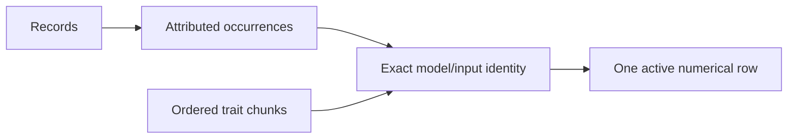

# Embedding ownership and occurrence retrieval

Research findings, 2026-11-01. This evaluates a revision to PR184; it does not
implement or approve a new retrieval contract. The earlier
[ingest measurements](database-ingest-simplification.md) remain evidence for their
recorded candidate. Accepted pipeline decisions and remaining work belong in the
[database/ingest backlog](../backlog/items/database-ingest-simplification.md).

The leading proposal is stable input-owned vectors to simplify ingest lifetime.
The corpus has only 0.629% duplicate document excess, and the tested shared-input
query was slower: about 10.4–13.5% in the equal-case warm SQL aggregates. The decision
therefore concerns ownership versus query cost, rather than an established search
speedup. Revised product implementation awaits user design input.

## Decision being evaluated

An embedding input identifies the exact text/preparation and model execution.
A semantic unit identifies an occurrence in a particular record/profile/location.
Several occurrences can use the same input. Today inference is deduplicated by
input, while sqlite-vec stores document vectors by occurrence. The first surviving
document occurrence also supplies the bytes reused for that input; trait-only
inputs have separate storage.

Compare three designs independently of the already agreed pipeline cleanup:

| Design | Persistent vectors | Publication lifetime | Retrieval change |
| --- | --- | --- | --- |
| A: occurrence index + owned staging | Existing document occurrence vectors and trait-only values | Preserve selected reused bytes before occurrence slots change | Existing KNN/occurrence contract |
| B: stable input index | One active searchable vector per exact model/input, referenced by occurrences and trait chunks | Existing input rows survive occurrence edits; replace forced values atomically and reclaim after consumers finish | Select eligible inputs, expand eligible occurrences, apply an explicit occurrence budget |
| C: stable authority + occurrence projection | Input-owned vectors plus the existing occurrence search index | Read stable authority while updating the search projection | Existing KNN/occurrence contract |

The [current freezer](../../crates/atlas-index/src/frozen_native_values.rs) addresses
a real lifetime problem in A. If occurrence 17 owns X today but needs Y tomorrow,
writing Y into slot 17 can destroy the only published copy of X before a later
occurrence or trait consumes it. The older eager pipeline retained reused vectors
in RAM. The guarded publisher fails and rolls back on a missing required value;
it does not automatically rerun inference during publication. Removing identity
checks could instead misattribute a valid-shaped vector.

B removes this particular hazard: occurrence 17 changes its reference from input
X to input Y; input X's numerical row stays in place for its other consumers.
This benefit does not depend on widespread duplicate text.

Many occurrences and trait chunks can reference one input. Record/occurrence IDs
and addresses stay independent of the vector row.

## Corpus sharing

Each of the two 768-dimensional profiles has the following exact metadata counts:

| Quantity | Per profile |
| --- | ---: |
| Document occurrences | 161,735 |
| Distinct document inputs | 160,718 |
| Duplicate excess | 1,017 (0.628806%) |
| Inputs used by multiple occurrences | 850 |
| Excess within records / across records | 694 / 323 |
| Maximum occurrences / records per input | 10 / 3 |
| Core occurrences / distinct inputs | 67,233 / 67,227 |
| Trait chunks / distinct trait inputs | 793 / 793 |
| Inputs shared between documents and traits | 0 |

All 29,813 identity inputs are unique; duplication is in passages. The largest
sharing groups are repeated owned-item prose within one creature. Across records,
307 inputs occur in two records and eight in three. Identical prose does not
necessarily mean identical prepared input.

The frozen AC and level+AC cohorts each contain 15,480 occurrences / 15,302 inputs;
owned-spell contains 30,215 / 29,855; price contains 953 / 953. Their measured Core
subsets have no duplicates. Core overall has only six excess occurrences/profile.

Across both profiles, collapsing document duplicates removes **6,248,448 logical
vector bytes (5.96 MiB)**. This is not a measured physical database saving. Adding
trait-only values to B's index gives 161,511 rows/profile versus 161,735 current
document vector rows: only 224 fewer index rows. Trait-only rows must remain
excluded from ordinary document KNN.

## Query experiment

The full sweep completed **192/192 cases**. Every returned hit satisfied the common
eligibility relation. Capped B matched A’s occurrence count and nearest-distance
multiset in all 192 cases. All three plans
were repeat-stable in all cases. Ordered occurrence IDs matched in 189 cases;
three changed one cutoff witness to another occurrence of the **same input and
same record at the exact same distance**. This is not exact witness parity.

The shared-input prototype was generally slower. At K=1,024, times below are
medians over four stored-seed case medians; each case median has four rounds.

| Eligible cohort | BGE occurrence → capped input (ms) | Gemma occurrence → capped input (ms) |
| --- | ---: | ---: |
| All roots | 259.7 → 303.6 | 258.6 → 302.9 |
| AC | 88.4 → 94.9 | 88.5 → 95.2 |
| Level + AC | 89.2 → 94.5 | 89.9 → 97.0 |
| Price | 68.6 → 68.7 | 67.2 → 68.1 |
| Owned spell | 110.0 → 120.2 | 108.1 → 118.1 |
| Core | 156.3 → 178.0 | 154.8 → 176.3 |
| Empty keys | 62.1 → 62.2 | 62.4 → 63.4 |
| All except Goblin | 260.0 → 304.2 | 260.0 → 307.5 |

Across 56 nonempty cases per K, the following aggregates give each case equal
weight. Ratios are geometric means of paired case-median ratios; deltas are
medians/ranges of paired case-median differences. Empty cases are excluded from
ratios and retain zero hits in both designs.

| Occurrence K | Shared/current ratio | Median delta (ms) | Delta range (ms) |
| --- | ---: | ---: | ---: |
| 256 | 1.135 | +10.17 | −2.76 to +81.69 |
| 1,024 | 1.104 | +10.01 | −2.81 to +60.31 |
| 4,096 | 1.120 | +13.38 | −0.23 to +55.47 |

These are serial warm observations, not confidence intervals or a general query
latency guarantee. Broad K=1,024 SQL costs about 44 ms more; selective AC costs
roughly 5–7 ms more. Price differences are small relative to sample variation.
B does more eligibility/mapping work, while the corpus offers little duplicate
reduction. Its K=1,024 broad case uses 2,951,218 VM steps versus 835,333 for A;
these are not native distance counts. All measured B query plans use indexed
input adjacency. Full-scan counters follow the returned native candidate count
rather than the earlier repeated whole-eligibility scans.

Uncapped unique-input expansion added occurrences in 80 cases and roots in 63;
maximum increases were 200 occurrences and 105 diagnostic roots. No relevance
benefit follows from those additional candidates. The complete invocation took
608.247s; recorded measured SQL samples sum to 327.130s. Warmups, setup, proofs,
hashes and evidence processing are outside the sample sum, so neither total is
an end-to-end product-search measurement.

### What the comparison measures

The isolated Rust probe uses Rust 1.95.0, SQLite 3.50.2 and sqlite-vec 0.1.9 with
existing release libraries. There is no inference, product dependency change or
model loading. A single read-only source connection supplies **the same original
occurrence/record metadata for both designs**; B reads only numerical rows from an
attached read-only prototype. Both databases have 8 MiB page caches and mmap=0,
an explicit experiment control rather than proof of shipping mapping equivalence.

Two profiles × four stored seeds (Heal, Goblin, Fireball, highest-shared input) ×
eight cohorts × K=256/1,024/4,096 gives 192 cases. Cohorts cover all roots, AC,
level+AC, price, owned spell, an empty key scope, Core and exclusion of Goblin.
Each plan has one warmup and four measured rounds with rotating plan order.
Four cyclic rounds are not fully position-balanced: each plan occupies one
position twice and the other positions once. Timing attribution remains limited.
Reported SQL time includes statement preparation, execution and minimal hit
collection. Root eligibility setup, hashes, query-plan capture and evidence writing
are outside that timer. Whole-process wall time is not query latency.

The three plans are current occurrence K, unique-input K with raw eligible
expansion, and unique-input K followed by an occurrence cap K. Eligibility is
applied **before** native selection; expansion admits only the original eligible
occurrences. Production location hydration, query-text inference, full search
aggregation, Hybrid fusion, remaster suppression, adaptive windows, cold caches
and relevance judgments are outside this experiment. Configured Similar
role/correspondence/identity masks and its separate 256-per-seed work contract
are also untested here; see the [candidate owner](../../crates/atlas-index/src/similarity_candidates.rs)
and [Similar service](../../crates/atlas-search/src/configurable_similarity.rs).
Diagnostic root summaries
are not product ranking or quality validation. VM/full-scan counters describe
SQLite work, not native cosine comparisons.

The refined B expansion drives the occurrence input index from KNN hits, then
checks eligible membership. A naïve materialized eligible-list join repeatedly
scanned the corpus per hit: two completed diagnostic cases were much slower and
the run was stopped. IN alone and CROSS JOIN alone also exposed poor plans on
fixtures. The final shape uses input adjacency plus a boolean membership filter;
its fixtures and actual three-case pilot removed N×K metadata work. This is a
query-planner dependency to protect with representative behavioral/work evidence,
not evidence that normalization inherently has that cost. The earlier WITH-prefix
guard failure occurred before any KNN case; it was a probe bug corrected with
SQLite's prepared-statement read-only check. All negative receipts remain retained.

### Candidate and tie semantics

K currently counts occurrence candidates before root aggregation. Giving B a
budget of K unique inputs and expanding everything changes work and coverage.
For example, the pilot's BGE/Heal/all-root K=4,096 returned 4,137 raw occurrences
and 3,983 roots, versus 4,096 occurrences and 3,948 roots after the occurrence cap.
That does not establish better product results.

Selecting the nearest K eligible inputs, expanding their eligible occurrences
and capping to K retains the nearest occurrence-distance multiset. Any omitted
input has K selected inputs at no greater distance, each supplying at least one
eligible occurrence, so it cannot improve the retained K distances. This does not
preserve exact cutoff IDs. Ties are a separate boundary. sqlite-vec chooses a bounded subset
before the outer ORDER BY sorts it. A fixture with 4,101 equal-distance unique
inputs and K=4,096 demonstrates that a capped unique index can return different
IDs from a fully deterministic total-order oracle while preserving distances.
A fixed oversampling factor cannot guarantee globally deterministic cutoff IDs.

The [production reader](../../crates/atlas-index/src/read_units.rs) and
[neighbor reuse owner](../../crates/atlas-search/src/neighbor_reuse.rs) expose
occurrence witnesses and cache generation/model/request/K identity. An input-based
native query must reconstruct those witnesses, update recipe/generation admission
as appropriate and preserve the occurrence window deliberately. Do not slice a
cached unique-input window as if it were an occurrence window. A future unique
coverage policy should be reviewed and evaluated separately.

## Storage, activation and recovery

B needs **one active row per input**, not permanent value-version history.
An exact input can have a different valid output after forced recomputation.
The prepared publication must bind its selected checksum as well as model/input
and token identity. Keep new bytes in the recovery cache and owned new-value
staging; replace that input's published row only inside atomic activation.
Activation must make all new-generation consumers use the selected value,
preserve the old publication and committed recovery results on rollback, and
clear recovery results only with a successful complete commit. Eviction must not
invalidate selected staged bytes.

Defer input reclamation until occurrence reconciliation and all trait consumers
finish. A last-document removal cannot delete a value still used by a trait.
Trait-only, pending and unreferenced migration rows must not enter document KNN.
Forced byte changes must invalidate dependent centroids even if input or seed-text
hashes are unchanged; numerical selection is also a dependency.
Profiles retain full execution identity. Preserve ordered/repeated trait chunks:
[X,T,X] must retain both X contributions and the existing accumulation order when
recomputing a centroid. The [trait writer](../../crates/atlas-index/src/traits.rs)
is a consumer of selected values as well as a producer of derived centroids.

The in-memory SQL fixtures exercise shared-input expansion and before-K
eligibility. Changing/deleting occurrence mappings leaves an input row readable
through a trait reference before rollback. Another fixture copies one pending
value into owned RAM,
deletes its cache entry, replaces the published vector/checksum, checks vector
rollback and commits a retry. It independently asserts vector bytes, not checksum
rollback. These are isolated feasibility proofs. They do not exercise persistent
staging, actual garbage collection, reverse trait transitions, ordered centroid
reconstruction, profile changes, schema migration, storage exhaustion, process crash/restart, saved-state
preservation or the product publisher.

A currently stages 992,323,584 logical selected vector bytes; the measured freezer
file occupied 1,514,827,776 bytes. Removing its whole-corpus cached-value copy is
B's main potential ingest/storage benefit. The measured freeze phase was 38.236s,
including reads, validation, writes and proofs; it is not a promised time saving.
Neither this file size nor phase duration is an irreducible minimum for a simpler A.
C would add 987,451,392 logical authority bytes after replacing trait-only storage,
plus table/allocation effects. It retains occurrence KNN but creates a second
permanent numerical representation; that tradeoff needs explicit acceptance.

The B prototype is 1,046,487,040 bytes and includes a numerical index plus compact
construction maps. It is **not a complete alternative Atlas database**. Its
345.451s construction includes public-value extraction, every source occurrence's
identity/byte validation, output checks and file hashing. It is not an optimized
migration or ingest benchmark. Steady physical size and migration main/WAL/temp/
backup peaks remain unmeasured. Atomic conversion can require old and new indexes
to coexist. Reclaimed SQLite pages need not reduce the database file size or
eliminate journal, WAL, temporary or backup space requirements. No product
migration or numerical representation change has been made.

A migration can use published values without inference: check every occurrence
and trait-only input through supported public APIs, fail if shared identities
have inconsistent bytes, preserve occurrence/public/saved identities and trait
centroids, validate the complete transformed transaction, then retire old storage.
Published historical migration callbacks remain immutable. Product integration
must measure migration and rebuild costs and exercise failure/rollback, force,
profile changes and saved state before calling the design ready.

## Recommendation and next evidence

The leading recommendation is **B with an occurrence cap**, for clearer numerical
ownership rather than deduplication speed. Keep record/occurrence identities and
attributed witnesses; store one active numerical row per exact input. Stage only
new/forced selected values, install them atomically, and reclaim unreferenced
values after document and trait consumers finish. Do not add permanent value
versions or a second full numerical authority.

The measured tradeoff is real: the isolated SQL comparison costs roughly
10.4–13.5% more by the equal-case geometric aggregates, including about 44 ms on
broad K=1,024 queries. **The tested normalized query was not faster on this
corpus**; other lowerings remain unevaluated. Its ownership benefit must justify that cost and the retrieval changes.
The observed three witness changes stay within a record; the synthetic large-tie
fixture shows why exact old cutoff IDs cannot be promised generally.

A remains the conservative fallback if the measured query cost or cutoff-witness
change is unacceptable: simplify its surrounding pipeline and retain one explicit
bounded selected-value copy. C retains the query contract but pays permanent
numerical duplication; the present evidence does not justify that tradeoff.

Before revised product implementation, obtain the user's design input on B's
query tradeoff and occurrence/tie policy. Then implement ownership, cache/staging
and captured-input cleanup together; validate real migration/rollback/traits/
force/profile/saved-state behavior and run matched completed rebuild/query
measurements. No alternative's ingest speed, physical migration peak or product
relevance improvement has yet been established.

The already accepted captured-input, owned-publication, bounded-batch, attempt
scratch and disposable recovery-cache changes apply to **all three designs**.
Their savings must be measured independently; none can be credited to input
normalization. Keep full validation of every real publication and the existing
forced rebuild/deep-audit semantics unless separately changed by agreement.

## Reproduction and retained evidence

Source reviewed: `e3819bd6f0e5acc87fd1247d678fdd065f489c3b`, a docs descendant of
PR184's measured implementation. Corpus: PF2e 8.6.1 `28d9d156…`, schema29,
reference revision9, context `1fa8e1c8…`, source SHA256
`11789d928487673be289778f3dc3dca9f51d61a08c9168da7c1661976a9c98c1`.
The source is 1,877,106,688 bytes. The prototype SHA256 is
`36b85f6ddd48ef7fefabe0f8d3e92349fcdf68fd2089f5cd0b9cdbaea04eaf60`.
The full sweep closed its handles and verified both database families unchanged.

Ignored task evidence lives under `scratch/database-ingest-ownership-research/`:
metadata query receipts, the reviewed `probe/ownership_probe.rs` and README,
prototype construction, failed/aborted diagnostics, pilot and full comparison.
The frozen spec SHA256 is
`ff740331e109bb57686980a51439675b60d349f513f4c832abc340ae8cc7ddf5`;
final comparator source/executable are `61ff909f…` / `370aae4d…`. Prototype
construction used `021c4616…` / `4d886254…`; it was not rebuilt for SQL refinements.
Receipts contain complete SQL/bindings, profiles, toolchain and artifact identities.
No product/model/source/installed workspace was modified by the experiment.
